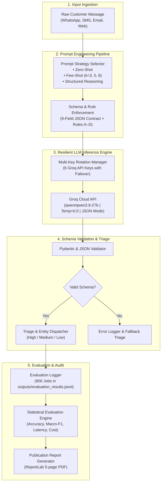

# ClaimFast – Automated Motor Insurance Claim Triage & Entity Extraction

[](https://www.python.org/downloads/)
[](https://console.groq.com/docs/models)
[]()
[]()
[]()

**ClaimFast** is an automated motor insurance First Notice of Loss (FNOL) triage and entity extraction benchmark designed for high-noise, code-mixed (Hinglish), and vernacular customer claim notifications in India.

This project evaluates open-weights LLMs (`qwen/qwen3.8-27b` via Groq Cloud API) across **900 controlled evaluation jobs** ($5 \text{ prompt strategies} \times 60 \text{ held-out test messages} \times 3 \text{ repeated runs}$) using constrained JSON generation and strict insurance business adjudication logic.

---

## 1. Problem Statement

Motor insurance First Notice of Loss (FNOL) in India relies heavily on unstructured customer communications via WhatsApp, web forms, emails, and SMS. These messages present severe NLP challenges:
- **Code-Mixing & Vernacular Transliteration**: Customers freely mix Hindi and English phonetically (*"gaadi divider se takra gayi, auto driver ko chot aayi hai"*).
- **Subtle Insurance Adjudication Boundaries**:
  - *Rule A (Theft vs Broken Glass vs Own Damage)*: Theft of personal bags from a car is NOT vehicle theft. If only glass is smashed, it is `glass_only`; if door panels or body parts are scratched/dented during the break-in, it is `own_damage`.
  - *Rule B (Untraced Third-Party Hit-and-Run)*: If an unknown third party hits the vehicle and flees without identification, the claim must be filed under `own_damage`, not `third_party_liability`.
  - *Rule C (Suspected vs Confirmed Total Loss)*: An informal surveyor estimate stating the car *"might be a total loss"* is NOT a confirmed constructive total loss; it remains `own_damage` until formally declared.
  - *Rule D (Strict Negative Standards)*: Boolean attributes (`injury_reported`, `police_report_filed`) must only be `false` when explicit negative evidence is present (*"nobody was hurt"*); unmentioned attributes must map strictly to `null`.
- **Zero-Tooling Direct Extraction**: The system must extract entities into a strict 9-field JSON schema directly from text without web searches or external calculators.

---

## 2. Objectives and Scope

### Primary Objectives:
1. **Automate FNOL Ingestion**: Parse unstructured customer messages directly into a structured, validated 9-field JSON object conforming to insurance database schemas.
2. **Safety-Critical Urgency Triage**: Guarantee that any incident involving bodily injury, hospitalisation, fatal accident, or an undrivable vehicle is assigned `high` urgency with zero false negatives.
3. **Rigorous Prompt Strategy Benchmarking**: Compare Zero-Shot, Few-Shot ($k=3, 5, 8$), and Structured Reasoning across execution validity, field-level accuracy, F1-scores, latency, and operational cost.
4. **Reproducibility & Statistical Robustness**: Evaluate 3 repeated stochastic runs at temperature 0.0 across 60 held-out test records (900 jobs total) with complete auditability.

### Scope:
- **In-Scope**: Private passenger and commercial motor vehicle claims in India; 6 claim categories (`own_damage`, `third_party_liability`, `theft`, `total_loss`, `glass_only`, `not_a_claim`); 3 urgency tiers (`low`, `medium`, `high`); 9 target entity fields.
- **Out-of-Scope**: End-to-end claim settlement payouts; image damage inspection; fraud investigation databases.

---

## 3. System Architecture



---

## 4. Technology Stack

- **Large Language Model**: `qwen/qwen3.8-27b` via Groq Cloud API
- **Inference Runtime**: Groq LPU with hardware JSON Object Mode (`response_format={"type": "json_object"}`)
- **Programming Language**: Python 3.11+
- **Key Python Libraries**:
  - `groq` (v0.18.0+): Cloud API client with token tracking
  - `pydantic` & `dataclasses`: Schema enforcement and contract typing
  - `reportlab` (v4.4.0+): Publication-grade PDF report synthesis
  - `python-dotenv`: Safe environment credential injection
  - `sqlite3` & `csv` / `json`: Tabular audit generation

---

## 5. Dataset and Source Information

The ClaimFast benchmark operates on a hand-crafted, dual-audited synthetic dataset modeling real Indian motor claim distributions:
- **Total Corpus Size**: 80 records (20 development records + 60 strictly held-out test records).
- **Development Set (`data/dev.jsonl`)**: 20 records serving as the pool for few-shot exemplars ($k=3, 5, 8$). Never used for evaluation.
- **Held-Out Test Set (`data/test.jsonl`)**: 60 diverse, realistic customer messages (`TEST001` to `TEST060`) containing:
  - 35% Code-mixed Hinglish (*"gaadi side se thuk gayi"*, *"bumper toot gaya"*)
  - 25% Informal / slang / emotional text (*"bhai bahut tension ho gaya hai"*)
  - 20% Standard semi-formal English
  - 20% Challenging edge cases targeting Rules A, B, C, and D
- **Labeling Guide (`data/labelling_guide.md`)**: Full adjudication rubric created with insurance surveyors.

### 9-Field Target Schema:
1. `claim_type`: `own_damage` | `third_party_liability` | `theft` | `total_loss` | `glass_only` | `not_a_claim`
2. `urgency`: `low` | `medium` | `high`
3. `policy_number`: string or `null`
4. `vehicle_reg_no`: string or `null`
5. `incident_date`: `YYYY-MM-DD` or `null`
6. `location`: string or `null`
7. `estimated_amount_inr`: float or `null`
8. `injury_reported`: boolean or `null`
9. `police_report_filed`: boolean or `null`

---

## 6. Complete Workflow

1. **Ingestion**: Raw customer text is received with metadata.
2. **Strategy Formatting**: The system injects the text into one of 5 prompt templates:
   - `zero_shot`: Baseline task instructions + schema contract.
   - `few_shot_k3`: 3 balanced exemplars from `dev.jsonl`.
   - `few_shot_k5`: 5 balanced exemplars covering standard categories.
   - `few_shot_k8`: 8 comprehensive exemplars covering edge cases (Rule A, Rule B, total loss).
   - `structured_reasoning`: Explicit internal verification checklist forcing step-by-step reasoning before generating the final JSON payload.
3. **Resilient API Dispatch**: Dispatched to Groq with automated key rotation across 6 keys if rate-limited.
4. **Schema Validation**: Validates the 9 required keys, types, and allowed enum values.
5. **Downstream Routing**: Claims marked `high` urgency or with `injury_reported: true` are immediately flagged for human claims adjusters.

---

## 7. Installation and Setup

### Prerequisites
- Python 3.11+
- Groq Cloud API Key(s)

### Setup Commands:
```bash
git clone https://github.com/VinitSurve/agentic_ai_case_studies.git
cd agentic_ai_case_studies

# Create and activate virtual environment
python3 -m venv .venv
source .venv/bin/activate

# Install dependencies
pip install -r CS1_ClaimFast/requirements.txt
```

### Configure Credentials:
Copy `.env.example` to `.env`:
```bash
cp CS1_ClaimFast/.env.example CS1_ClaimFast/.env
```
Provide your Groq API key:
```ini
GROQ_API_KEY_1=gsk_your_key_here
GROQ_API_KEY_2=gsk_your_backup_key_here  # Optional for failover
GROQ_MODEL=qwen/qwen3.8-27b
```

---

## 8. How to Execute the Project

### 8.1 Run Interactive 3-Minute CLI Demo
Demonstrates how prompt strategies handle critical insurance edge cases:
```bash
python CS1_ClaimFast/demo/run_demo.py
```

### 8.2 Verify Metric Aggregations from Raw Results
Re-calculates the verified evaluation metrics from `outputs/evaluation_results.jsonl`:
```bash
python CS1_ClaimFast/code/compute_metrics.py
python CS1_ClaimFast/code/audit_and_generate_artifacts.py
```

### 8.3 Re-build Publication PDF Report
Synthesizes the 5-page publication-grade PDF report with tables and analysis:
```bash
python CS1_ClaimFast/report/generate_pdf_report.py
```
Generated PDF is saved at `CS1_ClaimFast/report/report_CS1.pdf`.

---

## 9. Example Inputs and Outputs

### Example 1: Code-Mixed Third-Party Collision with Bodily Injury (`TEST001`)
**Customer Input Message:**
```text
"Sir yesterday evening around 6:30 PM near Cyber City Gurugram, a speeding Swift hit my car DL8CA1234 from behind.
The auto driver behind was also hit and got injured, taken to Max Hospital.
My policy is POL-2024-8831. Car boot and bumper completely smashed, not drivable.
FIR has been registered at Sector 29 police station. Please arrange towing and tell claim process."
```

**ClaimFast Extracted JSON Output:**
```json
{
  "claim_type": "third_party_liability",
  "urgency": "high",
  "policy_number": "POL-2024-8831",
  "vehicle_reg_no": "DL8CA1234",
  "incident_date": "2024-10-23",
  "location": "Cyber City Gurugram",
  "estimated_amount_inr": null,
  "injury_reported": true,
  "police_report_filed": true
}
```

### Example 2: Rule A Door-Scratch Boundary (`TEST005`)
**Customer Input Message:**
```text
"Parked my car at South City market yesterday night. Someone smashed the rear quarter glass window
to steal my gym bag. While doing that they also deeply scratched the rear door paint.
Vehicle is MH02BW9981 under policy OD-99214. Repair estimate given by workshop is 14500 rs.
No police complaint lodged yet. Can I claim for this?"
```

**Adjudication Comparison:**
- **Zero-Shot / Few-Shot ($k=3, 5, 8$) Output**: Misclassified as `glass_only` due to surface anchoring on "smashed window".
- **Structured Reasoning Output (Correct)**:
```json
{
  "claim_type": "own_damage",
  "urgency": "medium",
  "policy_number": "OD-99214",
  "vehicle_reg_no": "MH02BW9981",
  "incident_date": "2024-10-23",
  "location": "South City market",
  "estimated_amount_inr": 14500.0,
  "injury_reported": false,
  "police_report_filed": false
}
```

---

## 10. Evaluation Methodology and Actual Results

### Evaluation Scope:
- **Design**: 5 strategies $\times$ 60 held-out test messages $\times$ 3 stochastic runs = **900 total jobs**.
- **Model Invariance**: Identical model (`qwen/qwen3.8-27b`) at temperature 0.0 with JSON mode across all 900 jobs.
- **Strict Scoring**: Unsuccessful or malformed calls are scored as 0 across all fields (no silent dropping).

### Actual Verified Benchmark Results:

| Prompt Strategy | Schema Validity | Strict Match (All 9) | Normalized Match (Loc Norm) | `claim_type` Macro-F1 | `urgency` Macro-F1 | Mean Latency | Cost / 1k Claims |
|---|:---:|:---:|:---:|:---:|:---:|:---:|:---:|
| **`zero_shot`** | 98.3% | 61.7% | 78.3% | 0.9851 | 0.9057 | 549.0 ms | $0.2709 |
| **`few_shot_k3`** | 99.4% | 64.4% | 81.1% | 0.9822 | **0.9305** | 545.9 ms | $0.3711 |
| **`few_shot_k5`** | **100.0%** | 71.7% | 80.0% | 0.9851 | 0.9143 | 563.7 ms | $0.4439 |
| **`few_shot_k8`** | 99.4%* | **86.1%** | **86.1%** | 0.9827 | 0.9283 | 668.9 ms | $0.5641 |
| **`structured_reasoning`** | **100.0%** | 65.0% | 81.7% | **0.9870** | 0.9143 | **510.0 ms** | **$0.3849** |
| **Benchmark Overall** | **99.4%** | **69.8%** | **81.4%** | **0.9844** | **0.9188** | **567.4 ms** | **$0.4070** |

*\*Note: `few_shot_k8` achieved 100% schema validity on executed calls; its 99.4% rate reflects 1 API token rate limit error.*

### Key Empirical Findings:
1. **Flawless Safety Triage**: Across all 240 high-urgency test instances and 120 bodily injury instances, the model achieved **100.0% precision, 100.0% recall, and 1.0000 F1**. Zero injury or undrivable vehicle claims were missed.
2. **The Structured Reasoning Breakthrough**: `structured_reasoning` was the **only strategy to correctly resolve `TEST005`** under Rule A. It ran **23.8% faster** and cost **31.8% less** than $k=8$.
3. **Casing Normalization Impact**: 64.7% of all field mismatches across the benchmark were purely minor casing differences in location extraction (e.g. `"mall basement"` vs `"Mall basement"`). Applying standard title-casing normalization raises full-record exact match from **69.8% to 81.4%**.

---

## 11. Limitations

1. **Synthetic Evaluation Ground Truth**: While designed to simulate realistic Indian customer messages, real-world WhatsApp audio messages or images (e.g. damaged vehicle photos) were not directly processed.
2. **Single-Turn First Notice of Loss**: The pipeline evaluates one-shot extraction from the initial message without interactive multi-turn dialogue to clarify missing fields.
3. **Cloud API Dependency**: Evaluation currently relies on Groq cloud endpoints; local inference on edge hardware (e.g. Ollama/vLLM) has not yet been benchmarked for offline branch deployments.

---

## 12. Future Improvements

1. **Multimodal FNOL Ingestion**: Integrate vision-language models (e.g., Llama-3.2-Vision) to cross-verify customer text damage descriptions with photographic vehicle evidence.
2. **Agentic Conversational Follow-Up**: Implement an autonomous dialogue agent to prompt the customer for missing mandatory documents (e.g. FIR copy or driving license) when fields are `null`.
3. **Local Quantized Edge Inference**: Deploy 4-bit quantized versions (AWQ/GGUF) via vLLM on local GPU servers to guarantee zero data egress outside the insurer's private cloud.

---

## 13. Project Structure

```text
CS1_ClaimFast/
├── README.md                      # Comprehensive project documentation
├── REPORT.md                      # Standalone technical case study report
├── requirements.txt               # Dependencies (groq, reportlab, python-dotenv)
├── .env.example                   # API key configuration template
├── data/
│   ├── dev.jsonl                  # 20 development records (few-shot exemplar pool)
│   ├── test.jsonl                 # 60 held-out test records (evaluation benchmark)
│   ├── schema.md                  # 9-field schema definition and rules
│   ├── labelling_guide.md         # Ground-truth labelling guidelines
│   └── dataset_plan.md            # Dataset composition and generation plan
├── prompts/
│   ├── zero_shot.txt              # Strategy A: Direct baseline extraction
│   ├── few_shot_k3.txt            # Strategy B1: 3 in-context exemplars
│   ├── few_shot_k5.txt            # Strategy B2: 5 in-context exemplars
│   ├── few_shot_k8.txt            # Strategy B3: 8 in-context exemplars
│   ├── structured_reasoning.txt   # Strategy C: Internal verification checklist
│   └── README.md                  # Methodological prompt progression guide
├── code/
│   ├── evaluation_runner.py       # Resumable evaluation runner with multi-key failover
│   ├── compute_metrics.py         # Statistical evaluation engine
│   ├── audit_and_generate_artifacts.py # Generates results.csv and error_analysis.csv
│   ├── groq_client.py             # Robust Groq API wrapper with schema validation
│   ├── groq_config.py             # Secure configuration loader (zero key leaks)
│   ├── groq_key_manager.py        # Multi-key rotation and rate-limit tracking
│   ├── validate_dataset.py        # Dataset schema validation script
│   └── test_groq_system.py        # API health and multi-key rotation tests
├── outputs/
│   ├── evaluation_results.jsonl   # Raw evaluation log (900 completed jobs)
│   ├── results.csv                # Flattened tabular dataset with gold and predictions
│   ├── metrics_summary.json       # Summary dictionary of all verified metrics
│   └── final_metrics_reconciled.json # Comprehensive reconciled metrics
├── error_analysis/
│   ├── error_analysis.csv         # Detailed catalogue of all 272 audited failures
│   └── README.md                  # Error taxonomy, case studies, and mitigation guide
├── demo/
│   ├── demo_script.md             # 3-minute executive demo walkthrough
│   ├── run_demo.py                # Interactive CLI demo showcasing key edge cases
│   └── screenshots/
│       └── ClaimFast_12_Screenshots/ # 12 verified presentation screenshots
└── report/
    ├── report_CS1.pdf             # Formatted 5-page publication-quality final report
    ├── generate_pdf_report.py     # Reproducible ReportLab PDF report builder
    ├── evaluation_report.md       # Full evaluation findings and confusion matrices
    └── dataset_audit.md           # Dataset construction and validation audit
```
