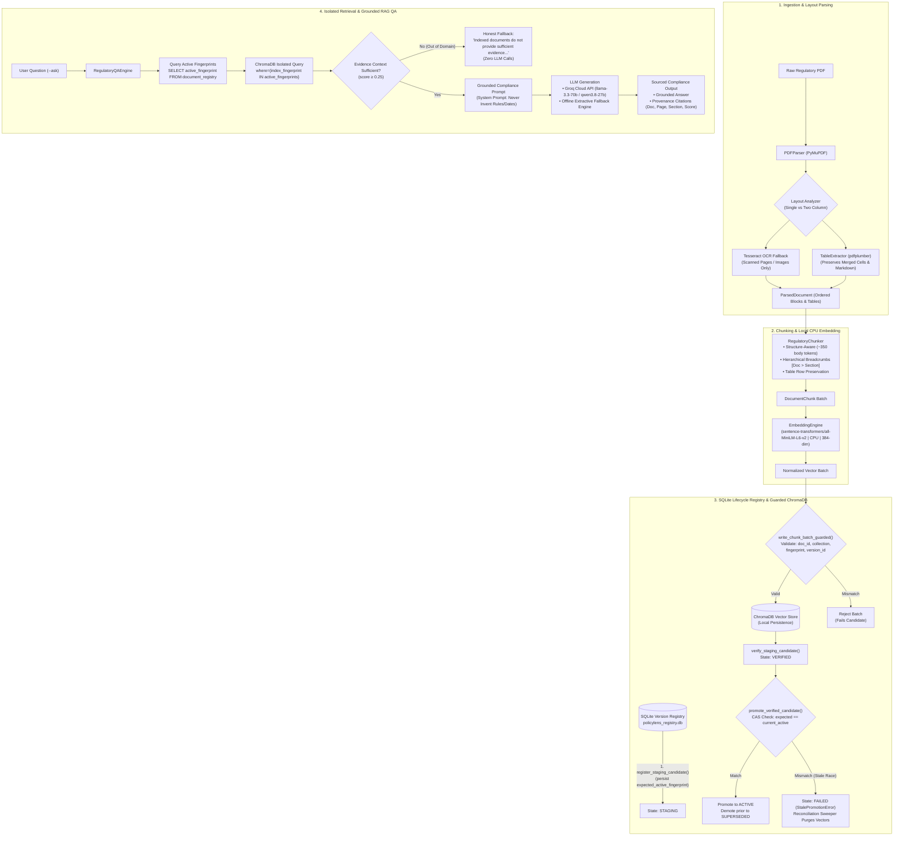

# PolicyLens: Regulatory Document Ingestion, Lifecycle Indexing & Grounded RAG Question Answering

[](https://www.python.org/downloads/)
[]()
[]()
[]()
[]()

**PolicyLens** is an enterprise-grade regulatory compliance document intelligence, indexing, and question-answering system developed for Indian financial institutions (governed by RBI, SEBI, IRDAI, and the Ministry of Finance).

PolicyLens overcomes the critical vulnerabilities of naive RAG systems in compliance domains: vector contamination from superseded circulars, race conditions during indexing, broken multi-column reading orders, merged-cell table distortion, and regulatory hallucinations. It couples layout-aware parsing, atomic Compare-And-Swap (CAS) lifecycle management, fenced worker leases, strictly isolated ChromaDB retrieval, and grounded RAG question answering.

---

## 1. Problem Statement

Indian financial regulations (Master Directions, circulars, notifications) are issued continuously by multiple authorities (RBI, SEBI, IRDAI, DFS). Compliance officers and audit teams face major challenges:
- **Complex Multimodal Document Structures**: Regulatory circulars frequently feature multi-column layouts, full-width advisory banners, scanned image annexures, and tables with multi-line text and merged headers. Standard text extraction collapses column reading order and scrambles table rows.
- **Dynamic Policy Lifecycle & Stale Vectors**: Regulators constantly issue circulars that supersede, amend, or revoke previous instructions. In naive vector databases, old vectors remain searchable indefinitely, leading RAG systems to cite repealed guidelines or superseded interest rates.
- **Worker Concurrency & Poisoned Indices**: In distributed indexing, worker crashes, network partitions, or delayed writes can cause orphaned vectors or late batches from failed workers to contaminate production collections.
- **Zero-Tolerance for Hallucination**: An AI compliance assistant must never invent circular numbers, penalty amounts, compliance deadlines, or regulatory clauses. If indexed evidence is lacking, it must provide an honest disclaimer.

---

## 2. Objectives and Scope

### Primary Objectives:
1. **Accurate Structural PDF Parsing**: Reconstruct reading order across single- and two-column layouts; extract structured tables into clean Markdown; trigger OCR (Tesseract) strictly on raster/scanned content while preserving native text.
2. **Structure-Aware Chunking**: Preserve regulatory clause boundaries, section hierarchies, and Markdown table integrity with breadcrumb headers (`[Document > Section]`).
3. **Provably Safe Lifecycle Versioning**: Implement a SQLite-backed state machine (`staging` $\to$ `verified` $\to$ `active` / `superseded` / `revoked` / `failed`) with atomic Compare-And-Swap (CAS) candidate promotion, monotonically increasing fencing tokens, and process-start lease validation.
4. **Guarded ChromaDB Storage & Isolated Retrieval**: Pre-validate all vector batch metadata against expected context; retrieve vectors strictly from active document fingerprints.
5. **Grounded Question Answering (`--ask`)**: Provide an authoritative RAG engine with strict anti-hallucination prompting, complete source provenance (Document ID, Page, Section, Score), and automatic fallback between cloud LLMs (Groq) and deterministic extractive summaries.

### Scope:
- **Target Regulators**: Reserve Bank of India (RBI), Securities and Exchange Board of India (SEBI), Insurance Regulatory and Development Authority of India (IRDAI), Department of Financial Services (DFS/GOI).
- **Corpus**: 40 official regulatory documents comprising 1,123 pages catalogued in `data/manifest.csv`.

---

## 3. System Architecture



---

## 4. Technology Stack

- **PDF Parsing & Geometry**: `PyMuPDF` (fitz v1.23.0+) for high-speed font extraction, bounding boxes, and image rendering.
- **Table Extraction**: `pdfplumber` (v0.10.0+) for precision line detection and cell merging reconstruction.
- **OCR Engine**: `pytesseract` / Tesseract OCR ($\ge 5.0$) for selective raster text recovery.
- **Vector Embeddings**: `sentence-transformers/all-MiniLM-L6-v2` (384 dimensions, normalized float vectors, running locally on CPU).
- **Vector Storage**: `chromadb` (v0.4.22+) local embedded client with HNSW cosine distance indexing (`hnsw:space: cosine`).
- **Lifecycle Registry**: `sqlite3` with strict Foreign Key constraints (`PRAGMA foreign_keys = ON;`), state-transition triggers, and atomic Compare-And-Swap (CAS) transactions.
- **LLM Question Answering**: `groq` Cloud API client (`llama-3.3-70b-versatile`, `qwen/qwen3.8-27b`, `openai/gpt-oss-120b`) with local extractive summarization fallback.
- **Testing & Verification**: Python standard `unittest` framework with deterministic mock engines for sub-second, zero-network test suite execution.

---

## 5. Dataset and Source Information

The PolicyLens regulatory corpus represents official Master Directions, circulars, notifications, and gazette orders published by Indian financial regulators:
- **Total Catalogued Documents**: 40 regulatory PDFs
- **Total Corpus Page Count**: 1,123 pages
- **Total Corpus Disk Size**: 30.75 MB
- **Corpus Manifest**: Detailed metadata catalogued in [`data/manifest.csv`](file:///Users/vinit/Vinit/ITM/Agent%20AI%20Foundations/LLM_Case_Studies/CS2_PolicyLens/data/manifest.csv)

### Distribution by Issuing Authority:
1. **Reserve Bank of India (RBI)**: 22 documents (commercial banking, small finance banks, NBFCs, digital payments, pensions, KYC guidelines, internal ombudsman directions).
2. **Department of Financial Services, Ministry of Finance (DFS/GOI)**: 9 documents (public sector banking governance, gazette notifications, financial inclusion directives).
3. **Securities and Exchange Board of India (SEBI)**: 8 documents (LODR amendments, mutual fund regulations, stock broker risk management, cyber security frameworks).
4. **Insurance Regulatory and Development Authority of India (IRDAI)**: 1 document (master directions on insurance compliance and grievance redressal).

---

## 6. Complete Ingestion and Lifecycle Workflow

```
Step 1: Receive PDF + Document Metadata
           │
Step 2: PDFParser layout detection (single vs two-column, table detection, selective OCR)
           │
Step 3: RegulatoryChunker structure-aware splitting (~350 body tokens + breadcrumbs)
           │
Step 4: Compute deterministic index fingerprint (SHA256 of canonical chunk representations)
           │
Step 5: Check Active Registry -> If active fingerprint matches exactly, return SKIPPED (Idempotency)
           │
Step 6: register_staging_candidate() -> SQLite persists expected_active_fingerprint, lease, fencing_token=1
           │
Step 7: EmbeddingEngine encodes text on CPU into 384-dimensional normalized vectors
           │
Step 8: write_chunk_batch_guarded() -> Verifies 4 core metadata attributes before calling ChromaDB.add()
           │
Step 9: verify_staging_candidate() -> Verifies chunk counts and transitions state: STAGING -> VERIFIED
           │
Step 10: promote_verified_candidate() -> Atomic CAS: checks expected_active_fingerprint matches current active;
         promotes candidate to ACTIVE; demotes prior active to SUPERSEDED in one atomic SQLite transaction.
```

---

## 7. Installation and Setup

### Prerequisites
- Python 3.11+
- Tesseract OCR (`brew install tesseract` on macOS / `apt-get install tesseract-ocr` on Ubuntu)

### Environment Setup
```bash
git clone https://github.com/VinitSurve/agentic_ai_case_studies.git
cd agentic_ai_case_studies

# Create and activate virtual environment
python3 -m venv .venv
source .venv/bin/activate

# Install dependencies
pip install -r CS2_PolicyLens/requirements.txt
```

### Configure Credentials (Optional for Cloud LLM)
Create a `.env` file in `CS2_PolicyLens/` or root:
```ini
GROQ_API_KEY_1=gsk_your_groq_api_key_here
```
*Note: If no API key is provided, PolicyLens automatically runs in offline mode using its built-in extractive regulatory fallback.*

---

## 8. How to Execute the Project

PolicyLens provides a single unified CLI entry point via [`index.py`](file:///Users/vinit/Vinit/ITM/Agent%20AI%20Foundations/LLM_Case_Studies/CS2_PolicyLens/index.py):

### 8.1 Index a Regulatory PDF
```bash
python CS2_PolicyLens/index.py --index \
    --pdf CS2_PolicyLens/data/pdfs/rbi_disbursement_pension_2026.pdf \
    --doc-id rbi_pension_2026 \
    --collection policylens_structure
```

**Output:**
```text
[*] Indexing PDF: CS2_PolicyLens/data/pdfs/rbi_disbursement_pension_2026.pdf
[+] Status: SUCCESS
    Document ID: rbi_pension_2026
    Version ID:  rbi_pension_2026_20261107121318_556144
    Fingerprint: 15a331d00e60e3c4c32a48e9bc268dd512f2fa8dcc14948530d6686998a571dc
    Chunks:      19
    Message:     Document successfully parsed, embedded, indexed, and promoted.
```

### 8.2 Check Active Registry Status
```bash
python CS2_PolicyLens/index.py --status
```

**Output:**
```text
[+] Active Document Registry (1 documents indexed):
  • rbi_pension_2026 [policylens_structure] -> Version: rbi_pension_2026_20261107121318_556144 | Chunks: 19 | Promoted: 2026-11-07T12:13:28+00:00
```

### 8.3 Query Active Corpus Vectors
```bash
python CS2_PolicyLens/index.py \
    --query "rules for recovery of excess pension payments" \
    --top-k 3
```

**Output:**
```text
[*] Querying collection 'policylens_structure': "rules for recovery of excess pension payments"
[+] Found 3 matching chunks:

--- Result 1 | rbi_pension_2026 (Page 6) (score: 0.6948) ---
[rbi_pension_2026 > 9. Whenever such excess/wrongful pension payment is made due to Government]
The banks may ensure that no recovery of excess amount from the pension of a Government employee
shall be effected without the pensioner’s knowledge and consent, or without the issuance of a prior notice...
```

### 8.4 Ask a Grounded Regulatory Question (`--ask`)
```bash
python CS2_PolicyLens/index.py \
    --ask "What are the rules for recovery of excess or wrong pension payments?"
```

**Output:**
```text
[*] Processing Question: "What are the rules for recovery of excess or wrong pension payments?"

======================================================================
QUESTION:
What are the rules for recovery of excess or wrong pension payments?
----------------------------------------------------------------------
ANSWER:
Based on the provided regulatory context from the rbi_pension_2026 document, the rules for the recovery of excess or wrongful pension payments are categorized by the source of the error (Agency Bank vs. Government) and follow specific procedural guidelines.

1. General Principles for Recovery
* Consent and Notice: Banks must ensure that no recovery of excess amounts from a pensioner’s pension is effected without the pensioner’s knowledge and consent, or without the issuance of a prior notice. Any recovery must strictly conform to applicable service rules.
  * Source: [Source 1 | Document: rbi_pension_2026 | Page 6 | Section 9]
* Letter of Undertaking: Banks may take a Letter of Undertaking from the pensioner stating that if any excess pension is credited, the pensioner is bound to refund it upon receipt of a suitable notice from the bank.
  * Source: [Source 1 | Document: rbi_pension_2026 | Page 6 | Section 9]
* Board-Approved Policy: Banks must put in place a Board-approved policy on the recovery of excess/wrongful pension payments, including a defined cut-off period beyond which no recovery shall be made.
  * Source: [Source 1 | Document: rbi_pension_2026 | Page 6 | Section 8(iii)]

2. Agency Bank-Attributed Errors
If the excess/wrongful payment is due to bank-attributed errors (e.g., clerical errors, arithmetical miscalculations):
* Immediate Credit to Government: The entire excess amount must be credited to the Government account in a lump sum immediately upon detection.
  * Source: [Source 1 | Document: rbi_pension_2026 | Page 6 | Section 8(i)]
* Recovery Procedure (Annex III):
  1. Written Notice to pensioner with details of excess payment and opportunity to represent.
  2. Methods of Recovery (in order of preference):
     - Available Balance Method (protecting minimum balance)
     - Percentage of Pension Method (capped deduction)
     - Pensioner-Requested Method (lump-sum or customized instalments)
----------------------------------------------------------------------
STATUS: SUCCESS
ENGINE: groq/qwen/qwen3.8-27b
======================================================================

SOURCES CITED (5):
  [1] Document: rbi_pension_2026 | Page: 6 | Section: 9. Whenever such excess/wrongful pension payment is made due to Government | Score: 0.6948
  [2] Document: rbi_pension_2026 | Page: 20 | Section: 3. No recovery shall be initiated after a defined cut-off period unless: | Score: 0.6603
  [3] Document: rbi_pension_2026 | Page: 18 | Section: List of circulars repealed by the Master Direction | Score: 0.5711
  [4] Document: rbi_pension_2026 | Page: 19 | Section: List of circulars repealed by the Master Direction | Score: 0.5676
  [5] Document: rbi_pension_2026 | Page: 20 | Section: List of circulars repealed by the Master Direction | Score: 0.5552
```

### 8.5 Demonstrate Insufficient-Context Handling (Honest Fallback)
```bash
python CS2_PolicyLens/index.py \
    --ask "What is the speed of light in vacuum and the capital of Mars?"
```

**Output:**
```text
[*] Processing Question: "What is the speed of light in vacuum and the capital of Mars?"

======================================================================
QUESTION:
What is the speed of light in vacuum and the capital of Mars?
----------------------------------------------------------------------
ANSWER:
The available indexed regulatory documents do not provide sufficient evidence to answer this question. Please verify that the relevant circulars or master directions have been indexed.
----------------------------------------------------------------------
STATUS: INSUFFICIENT_CONTEXT
ENGINE: None
======================================================================

SOURCES CITED: None (Insufficient evidence context)
```

---

## 9. Example Inputs and Outputs

### Example 1: Table Extraction with Merged Headers
**Source**: RBI Master Direction repealed circulars list (Table across multiple rows).
**Extracted Markdown Representation**:
```markdown
[rbi_pension_2026 > List of circulars repealed by the Master Direction (Table)]

| S.No. | Circular No. | Date | Subject |
| --- | --- | --- | --- |
| 1 | DGBA.GAD.No.130/45.01.001/2002-03 | 30.08.2002 | Single Window System for Reimbursement of pension payments made to Central Government Civil Pensioners |
| 2 | RBI/2004/81/DGBA.GAD.No.H-864/45.01.001/2003-04 | 26.02.2004 | Scheme for payment of pension to Central Civil/Defence/Railway/Telecom Pensioners through Agency Banks |
```

### Example 2: Idempotent Re-indexing Check
**Input Command**: Re-index the exact same PDF without modifications.
**Output**:
```text
[*] Indexing PDF: CS2_PolicyLens/data/pdfs/rbi_disbursement_pension_2026.pdf
[+] Status: SKIPPED
    Document ID: rbi_pension_2026
    Version ID:  rbi_pension_2026_20261107121318_556144
    Fingerprint: 15a331d00e60e3c4c32a48e9bc268dd512f2fa8dcc14948530d6686998a571dc
    Chunks:      19
    Message:     Document is already actively indexed with identical fingerprint.
```

---

## 10. Evaluation Methodology and Actual Results

### Automated Test Architecture:
Testing is organized into 4 isolated test suites totaling **38 unit and integration tests**. To guarantee reproducibility, sub-second execution, and zero external network dependencies, tests utilize in-memory SQLite, `MockEmbeddingEngine` (384-dim deterministic unit vectors), `MockChromaClient`, and `MockLLM`.

```bash
cd LLM_Case_Studies && .venv/bin/python -m unittest discover -s CS2_PolicyLens/tests -p "test_*.py" -v
```

### Actual Verified Results (All 38 Tests Passing in 1.1s):
```text
test_chromadb_metadata_validation_during_indexing (test_indexing_pipeline) ... ok
test_failed_indexing_preserves_previously_active_version (test_indexing_pipeline) ... ok
test_reindexing_unchanged_document_skips_and_preserves_active (test_indexing_pipeline) ... ok
test_retrieval_excludes_inactive_versions (test_indexing_pipeline) ... ok
test_successful_pdf_indexing_lifecycle (test_indexing_pipeline) ... ok
test_cas_promotion_success_from_scratch (test_lifecycle_registry) ... ok
test_persisted_expected_fingerprint_behavior (test_lifecycle_registry) ... ok
test_promotion_rejected_if_state_not_verified (test_lifecycle_registry) ... ok
test_promotion_rejected_on_worker_id_or_fencing_token_mismatch (test_lifecycle_registry) ... ok
test_stale_candidate_rejected_in_two_candidate_race (test_lifecycle_registry) ... ok
test_verification_rejected_on_worker_or_token_mismatch (test_lifecycle_registry) ... ok
test_empty_active_registry_returns_empty_without_chroma_query (test_lifecycle_registry) ... ok
test_late_write_reconciliation_and_sweeper_idempotency (test_lifecycle_registry) ... ok
test_reconciliation_collection_scoping_regression (test_lifecycle_registry) ... ok
test_retrieval_strictly_filters_active_fingerprints (test_lifecycle_registry) ... ok
test_migration_preserves_records_foreign_keys_and_indexes (test_lifecycle_registry) ... ok
test_migration_rollback_on_failure (test_lifecycle_registry) ... ok
test_post_migration_trigger_enforces_legal_transitions (test_lifecycle_registry) ... ok
test_empty_expected_context_rejected_before_batch (test_lifecycle_registry) ... ok
test_mismatched_collection_name_blocks_chroma_add (test_lifecycle_registry) ... ok
test_mismatched_document_id_blocks_chroma_add (test_lifecycle_registry) ... ok
test_mismatched_index_fingerprint_blocks_chroma_add (test_lifecycle_registry) ... ok
test_mismatched_version_id_blocks_chroma_add (test_lifecycle_registry) ... ok
test_valid_metadata_calls_chroma_add (test_lifecycle_registry) ... ok
test_determinism_and_serialization (test_pdf_parser) ... ok
test_genuine_merged_cells_table (test_pdf_parser) ... ok
test_genuinely_blank_page_skips_ocr (test_pdf_parser) ... ok
test_hybrid_native_with_ocr_region (test_pdf_parser) ... ok
test_overlapping_images_coverage_union (test_pdf_parser) ... ok
test_scanned_page_ocr_fallback (test_pdf_parser) ... ok
test_single_column_parsing (test_pdf_parser) ... ok
test_structured_table_extraction (test_pdf_parser) ... ok
test_two_column_reading_order_reconstruction (test_pdf_parser) ... ok
test_extractive_fallback_when_offline_or_unconfigured (test_rag_qa) ... ok
test_grounded_answer_generation_with_mock_llm (test_rag_qa) ... ok
test_inactive_and_revoked_document_chunks_strictly_excluded (test_rag_qa) ... ok
test_insufficient_context_honest_fallback_zero_llm_calls (test_rag_qa) ... ok
test_source_references_exact_structure (test_rag_qa) ... ok

----------------------------------------------------------------------
Ran 38 tests in 1.136s

OK
```

---

## 11. Limitations

1. **Physical Page Break Boundary on Multi-Page Tables**: Large regulatory tables that cross physical page breaks are segmented at page boundaries with `is_continued` metadata flags rather than merged into a single multi-page object.
2. **Third-Party OCR Binary Dependency**: Full-page OCR fallback performance is contingent upon the local system Tesseract installation (`tesseract --version` $\ge 5.0$).
3. **Client-Side Timeout Drift on Remote ChromaDB**: High-latency remote ChromaDB instances rely on client-side HTTP timeouts ($T \le 30\text{s}$) and the background sweeper for eventual cleanup of orphaned vector batches.

---

## 12. Future Improvements

1. **Cross-Page Table Stitching**: Implement automatic column alignment recognition across consecutive page boundaries to stitch split tables before chunking.
2. **Hybrid Dense + Sparse Search**: Integrate BM25 sparse keyword matching alongside dense vector retrieval to enhance keyword precision on exact circular notification numbers (e.g., `RBI/2025-26/381`).
3. **Automated Regulatory Differential Highlighting**: When an active circular supersedes a prior version, automatically generate a diff summary highlighting amended clauses and altered compliance deadlines.

---

## 13. Project Structure

```text
CS2_PolicyLens/
├── README.md                      # Comprehensive project documentation
├── REPORT.md                      # Standalone technical case study report
├── index.py                       # Root CLI entry point (--index, --status, --query, --ask)
├── requirements.txt               # Dependencies (PyMuPDF, pdfplumber, ChromaDB, SentenceTransformers)
├── data/
│   ├── manifest.csv               # Complete audit catalog of all 40 regulatory PDFs
│   ├── pdfs/                      # Official Indian regulatory PDF corpus (1,123 pages)
│   ├── policylens_registry.db     # SQLite lifecycle and document registry database
│   └── chroma_db/                 # Local ChromaDB vector storage directory
├── src/
│   ├── __init__.py                # Package exports
│   ├── config.py                  # Central configuration paths, thresholds, and parameters
│   ├── models.py                  # Structured intermediate representations (Pydantic / Dataclasses)
│   ├── pdf_parser.py              # Multimodal PDF extraction pipeline
│   ├── layout_analyzer.py         # Reading order reconstruction and two-column analyzer
│   ├── table_extractor.py         # Merged-cell table detector and Markdown renderer
│   ├── ocr_engine.py              # Tesseract OCR engine with bounding box mapping
│   ├── chunker.py                 # Structure-aware and fixed sliding-window chunkers
│   ├── embeddings.py              # Local CPU SentenceTransformers and mock embedding engines
│   ├── version_registry.py        # SQLite lifecycle state machine, CAS promotion, guarded writes
│   ├── indexing_pipeline.py       # End-to-end indexing, verification, retrieval, and CLI logic
│   └── rag_qa.py                  # Minimal RAG question-answering engine with Groq/offline fallback
└── tests/
    ├── test_pdf_parser.py         # 9 unit tests: layout, columns, tables, OCR fallback
    ├── test_lifecycle_registry.py # 19 unit tests: CAS promotion, race conditions, triggers, metadata
    ├── test_indexing_pipeline.py  # 5 integration tests: end-to-end lifecycle, failure preservation
    └── test_rag_qa.py             # 5 unit tests: grounded QA, provenance, honest fallback, isolation
```
