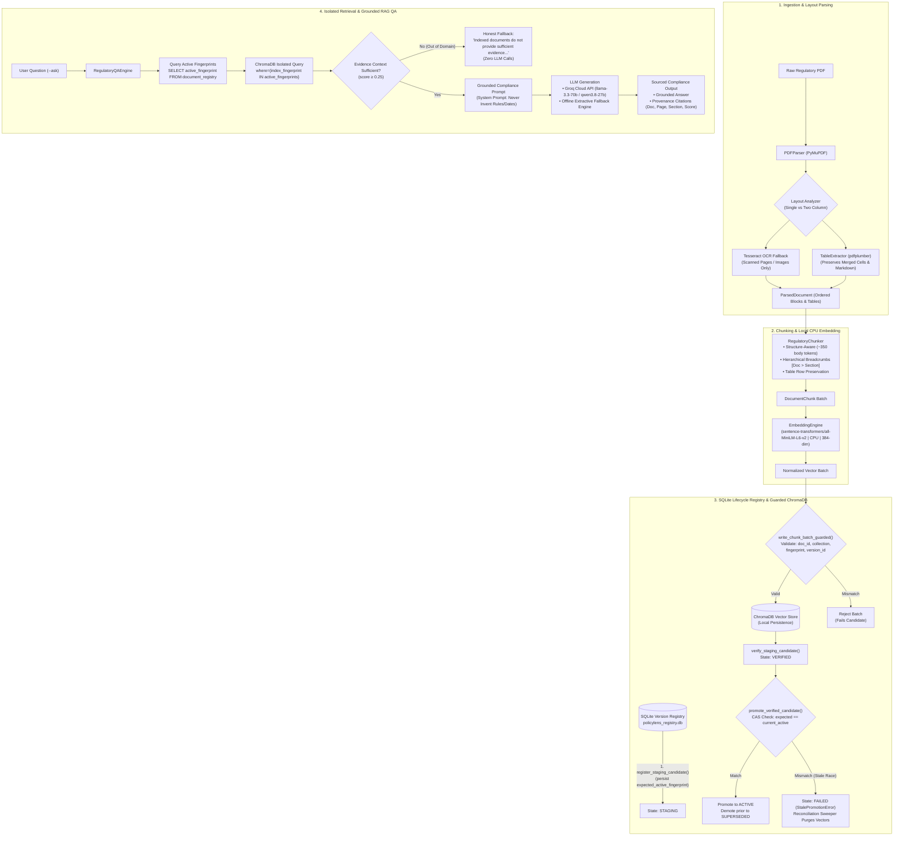

# PolicyLens: Regulatory Document Ingestion, Lifecycle Indexing & Grounded RAG Question Answering

[](https://www.python.org/downloads/)
[]()
[]()
[]()
[]()
[]()

**PolicyLens** is an enterprise-grade regulatory compliance document intelligence, indexing, and question-answering system developed for Indian financial institutions (governed by RBI, SEBI, IRDAI, and the Ministry of Finance).

PolicyLens is designed to mitigate the primary failure modes of naive RAG systems in compliance domains: vector contamination from superseded circulars, race conditions during indexing, broken multi-column reading orders, merged-cell table distortion, and unsupported regulatory answers. It couples layout-aware parsing, atomic Compare-And-Swap (CAS) lifecycle management, fenced worker leases, strictly isolated ChromaDB retrieval, and grounded RAG question answering.

---

## 1. Problem Statement

Indian financial regulations (Master Directions, circulars, notifications) are issued continuously by multiple authorities (RBI, SEBI, IRDAI, DFS). Compliance officers and audit teams face major challenges:
- **Complex Multimodal Document Structures**: Regulatory circulars frequently feature multi-column layouts, full-width advisory banners, scanned image annexures, and tables with multi-line text and merged headers. Standard text extraction collapses column reading order and scrambles table rows.
- **Dynamic Policy Lifecycle & Stale Vectors**: Regulators constantly issue circulars that supersede, amend, or revoke previous instructions. In naive vector databases, old vectors remain searchable indefinitely, leading RAG systems to cite repealed guidelines or superseded interest rates.
- **Worker Concurrency & Poisoned Indices**: In distributed indexing, worker crashes, network partitions, or delayed writes can cause orphaned vectors or late batches from failed workers to contaminate production collections.
- **Zero-Tolerance for Hallucination**: An AI compliance assistant must never invent circular numbers, penalty amounts, compliance deadlines, or regulatory clauses. If indexed evidence is lacking, it must provide an honest disclaimer.

---

## 2. Objectives and Scope

### Primary Objectives:
1. **Accurate Structural PDF Parsing**: Reconstruct reading order across single- and two-column layouts; extract structured tables into clean Markdown; trigger OCR (Tesseract) strictly on raster/scanned content while preserving native text.
2. **Structure-Aware Chunking**: Preserve regulatory clause boundaries, section hierarchies, and Markdown table integrity with breadcrumb headers (`[Document > Section]`).
3. **Enforced Lifecycle Consistency**: Implement a SQLite-backed state machine (`staging` $\to$ `verified` $\to$ `active` / `superseded` / `revoked` / `failed`) with atomic Compare-And-Swap (CAS) candidate promotion, monotonically increasing fencing tokens, and process-start lease validation.
4. **Guarded ChromaDB Storage & Isolated Retrieval**: Pre-validate all vector batch metadata against expected context; retrieve vectors strictly from active document fingerprints.
5. **Grounded Question Answering (`--ask`)**: Provide an authoritative RAG engine with strict anti-hallucination prompting, complete source provenance (Document ID, Page, Section, Score), and automatic fallback between cloud LLMs (Groq) and deterministic extractive summaries.

### Scope:
- **Target Regulators**: Reserve Bank of India (RBI), Securities and Exchange Board of India (SEBI), Insurance Regulatory and Development Authority of India (IRDAI), Department of Financial Services (DFS/GOI).
- **Corpus**: 40 official regulatory documents comprising 1,123 pages catalogued in `data/manifest.csv`.

---

## 3. System Architecture



---

## 4. Technology Stack

- **PDF Parsing & Geometry**: `PyMuPDF` (fitz v1.23.0+) for high-speed font extraction, bounding boxes, and image rendering.
- **Table Extraction**: `pdfplumber` (v0.10.0+) for precision line detection and cell merging reconstruction.
- **OCR Engine**: `pytesseract` / Tesseract OCR ($\ge 5.0$) for selective raster text recovery.
- **Vector Embeddings**: `sentence-transformers/all-MiniLM-L6-v2` (384 dimensions, normalized float vectors, running locally on CPU).
- **Vector Storage**: `chromadb` (v0.4.22+) local embedded client with HNSW cosine distance indexing (`hnsw:space: cosine`).
- **Lifecycle Registry**: `sqlite3` with strict Foreign Key constraints (`PRAGMA foreign_keys = ON;`), state-transition triggers, and atomic Compare-And-Swap (CAS) transactions.
- **LLM Question Answering**: `groq` Cloud API client (`llama-3.3-70b-versatile`, `qwen/qwen3.8-27b`, `openai/gpt-oss-120b`) with local extractive summarization fallback.
- **Testing & Verification**: Python standard `unittest` framework with deterministic mock engines for sub-second, zero-network test suite execution.

---

## 5. Dataset and Source Information

The PolicyLens regulatory corpus represents official Master Directions, circulars, notifications, and gazette orders published by Indian financial regulators:
- **Total Catalogued Documents**: 40 regulatory PDFs
- **Total Corpus Page Count**: 1,123 pages
- **Total Corpus Disk Size**: 30.75 MB
- **Corpus Manifest**: Detailed metadata catalogued in [`data/manifest.csv`](./data/manifest.csv)

### Distribution by Issuing Authority:
1. **Reserve Bank of India (RBI)**: 22 documents (commercial banking, small finance banks, NBFCs, digital payments, pensions, KYC guidelines, internal ombudsman directions).
2. **Department of Financial Services, Ministry of Finance (DFS/GOI)**: 9 documents (public sector banking governance, gazette notifications, financial inclusion directives).
3. **Securities and Exchange Board of India (SEBI)**: 8 documents (LODR amendments, mutual fund regulations, stock broker risk management, cyber security frameworks).
4. **Insurance Regulatory and Development Authority of India (IRDAI)**: 1 document (master directions on insurance compliance and grievance redressal).

---

## 6. Complete Ingestion and Lifecycle Workflow

```
Step 1: Receive PDF + Document Metadata
           │
Step 2: PDFParser layout detection (single vs two-column, table detection, selective OCR)
           │
Step 3: RegulatoryChunker structure-aware splitting (~350 body tokens + breadcrumbs)
           │
Step 4: Compute deterministic index fingerprint (SHA256 of canonical chunk representations)
           │
Step 5: Check Active Registry -> If active fingerprint matches exactly, return SKIPPED (Idempotency)
           │
Step 6: register_staging_candidate() -> SQLite persists expected_active_fingerprint, lease, fencing_token=1
           │
Step 7: EmbeddingEngine encodes text on CPU into 384-dimensional normalized vectors
           │
Step 8: write_chunk_batch_guarded() -> Verifies 4 core metadata attributes before calling ChromaDB.add()
           │
Step 9: verify_staging_candidate() -> Verifies chunk counts and transitions state: STAGING -> VERIFIED
           │
Step 10: promote_verified_candidate() -> Atomic CAS: checks expected_active_fingerprint matches current active;
         promotes candidate to ACTIVE; demotes prior active to SUPERSEDED in one atomic SQLite transaction.
```

---

## 7. Installation and Setup

### Prerequisites
- Python 3.11+
- Tesseract OCR (`brew install tesseract` on macOS / `apt-get install tesseract-ocr` on Ubuntu)

### Environment Setup
```bash
git clone https://github.com/VinitSurve/agentic_ai_case_studies.git
cd agentic_ai_case_studies

# Create and activate virtual environment
python3 -m venv .venv
source .venv/bin/activate

# Install dependencies
pip install -r CS2_PolicyLens/requirements.txt
```

### Configure Credentials (Optional for Cloud LLM)
Create a `.env` file in `CS2_PolicyLens/` or root:
```ini
GROQ_API_KEY_1=gsk_your_groq_api_key_here
```
*Note: If no API key is provided, PolicyLens automatically runs in offline mode using its built-in extractive regulatory fallback.*

---

## 8. How to Execute the Project

PolicyLens provides flexible CLI entry points via [`ingest.py`](./ingest.py) and [`search.py`](./search.py) (as well as unified entry point [`index.py`](./index.py)):

### 8.1 Batch Ingest Full Corpus (Assignment Command)
```bash
python CS2_PolicyLens/ingest.py \
    --input CS2_PolicyLens/data/pdfs \
    --manifest CS2_PolicyLens/data/manifest.csv \
    --collection policylens_v1
```

**Output:**
```text
[*] Starting Batch Ingestion: 40 documents -> Collection 'policylens_v1'
  [01/40] [+] INDEXED: rbi_internal_ombudsman_comm_2026 (16 pages, 17 chunks)
  ...
  [40/40] [+] INDEXED: sebi_net_settlement_mf_2026 (5 pages, 11 chunks)

=================================================================
INGESTION BATCH SUMMARY
=================================================================
Collection Name:             policylens_v1
Manifest Document Count:     40
Successfully Indexed:        40
Skipped (Unchanged/Cached):  0
Failed Count:                0
Total Pages Processed:       1123
Total Chunks Active:         1604
New Chunks Added:            1604
Active Document Count:       40
Execution Duration:          187.87 seconds
=================================================================
```

### 8.2 Filtered Search with Document Title, Page & Section (Assignment Command)
```bash
python CS2_PolicyLens/search.py "what is the minimum threshold of banking outlets for commercial banks" --collection policylens_v1 --top_k 3 --filter "issuer=RBI"
```

**Output:**
```text
[*] Applied metadata filter 'issuer=RBI' (22 matching documents).
[*] Searching collection 'policylens_v1': "what is the minimum threshold of banking outlets for commercial banks"
[+] Found 3 matching chunks (Active Versions Only | Hybrid Candidates | Config 4 Rerank | Pool: 60 -> 48):

--- Result 1 | Reserve Bank of India (Commercial Banks - Internal Ombudsman) Directions, 2026 (Reserve Bank of India (RBI)) [both] ---
    Document ID: rbi_internal_ombudsman_comm_2026 | Page: 2 | Section: (1) In these Directions, unless the context states otherwise, the terms herein shall | Score: 0.7007 (Dense: 0.5279, Boost: +0.0528)
    Text Preview:
    In these Directions, unless the context states otherwise, the terms herein shall] banking outlets in India as on March 31, 2025, whether such bank is incorporated in India or outside India. For the purpose of these Directions, ‘Commercial Banks’ mean banking companies...

--- Result 2 | Reserve Bank of India (Commercial Banks – Credit Valuation Adjustment Framework) Directions, 2026 (Reserve Bank of India (RBI)) [dense] ---
    Document ID: rbi_cva_framework_2026 | Page: 2 | Section: (a) regulatory CVA excludes the effect of the bank’s own default; and | Score: 0.6693 (Dense: 0.5043, Boost: +0.0450)
    Text Preview:
    3. These Directions shall be applicable to Commercial Banks (hereinafter collectively referred to as 'banks' and individually as a 'bank'). For the purpose of these Directions, ‘Commercial Banks’ means banking...

--- Result 3 | Reserve Bank of India (Commercial Banks - Minimum Capital Requirements for Market Risk) Directions, 2026 (Reserve Bank of India (RBI)) [dense] ---
    Document ID: rbi_market_risk_2026 | Page: 3 | Section: the Reserve Bank of India (Commercial Banks – Classification, Valuation, and | Score: 0.6626 (Dense: 0.4933, Boost: +0.0493)
    Text Preview:
    Act, 1949 (hereinafter called the Act), the Reserve Bank of India (hereinafter called the Reserve Bank), being satisfied that it is necessary and expedient in the public interest so to do, hereby, issues the Directions hereinafter specified. Chapter-I: Preliminary...
```

### 8.3 Check Active Registry Status
```bash
python CS2_PolicyLens/ingest.py --status
```

### 8.4 Idempotent Re-Ingestion (Zero Duplicate Verification)
```bash
python CS2_PolicyLens/ingest.py \
    --input CS2_PolicyLens/data/pdfs \
    --manifest CS2_PolicyLens/data/manifest.csv \
    --collection policylens_v1
```

**Output:**
```text
=================================================================
INGESTION BATCH SUMMARY
=================================================================
Collection Name:             policylens_v1
Manifest Document Count:     40
Successfully Indexed:        0
Skipped (Unchanged/Cached):  40
Failed Count:                0
Total Pages Processed:       1123
Total Chunks Active:         1604
New Chunks Added:            0
Active Document Count:       40
Execution Duration:          0.09 seconds (2,087x speedup)
=================================================================
```

### 8.4 Ask a Grounded Regulatory Question (`--ask`)
```bash
python CS2_PolicyLens/search.py \
    --ask "Under IRAC directions, what is the definition of an out of order overdraft or cash credit account?" \
    --collection policylens_v1 \
    --top_k 5
```

**Output:**
```text
[*] Processing Grounded Question: "Under IRAC directions, what is the definition of an out of order overdraft or cash credit account?"

======================================================================
QUESTION:
Under IRAC directions, what is the definition of an out of order overdraft or cash credit account?
----------------------------------------------------------------------
ANSWER:
Under the IRAC directions, an Overdraft (OD) or Cash Credit (CC) account is classified as ‘out of order’ if any of the following conditions are satisfied:

1. The outstanding balance remains continuously in excess of the sanctioned limit/drawing power for ninety days;
2. There are no credits continuously for ninety days; or
3. Credits are not enough to cover the interest debited during the previous ninety days period.

Source: [Source 1 | Document: rbi_asset_class_irac_2026 | Page 7]

Additional Context:
* The definition of “out of order” applies to all funded loan products which are not in the nature of a term loan, except credit cards. [Source 1 | Page 7]
* The “previous ninety days period” for condition (iii) is inclusive of the day for which the day-end process is being run. [Source 1 | Page 7]
* An account is also considered for NPA classification if it is classified as ‘out of order’ in respect of an OD/CC. [Source 2 | Page 10]
----------------------------------------------------------------------
STATUS: SUCCESS
ENGINE: groq/qwen/qwen3.8-27b
======================================================================

SOURCES CITED (5):
  [1] Document: rbi_asset_class_irac_2026 | Page: 7 | Section: to evaluate the performance of the financial asset | Score: 0.7607
  [2] Document: rbi_asset_class_irac_2026 | Page: 10 | Section: (8) If interest / instalment from debt instruments | Score: 0.6391
  [3] Document: rbi_asset_class_irac_2026 | Page: 8 | Section: (ii) Once disbursed, sanctioned limit cannot be replenished | Score: 0.5387
  [4] Document: rbi_asset_class_irac_2026 | Page: 4 | Section: (iii) Lender Concessions | Score: 0.5179
  [5] Document: rbi_asset_class_irac_2026 | Page: 17 | Section: Annex 3 automation of Asset Classification | Score: 0.4980
```

### 8.5 Hybrid Search with Config 4 Calibrated Lexical Reranking
```bash
python CS2_PolicyLens/search.py \
    --query "When does a credit facility get classified as a non-performing asset or out of order?" \
    --collection policylens_v1 \
    --top_k 5 \
    --hybrid \
    --rerank \
    --denoise
```

**Output:**
```text
[*] Searching collection 'policylens_v1': "When does a credit facility get classified as a non-performing asset or out of order?"
[+] Found 5 matching chunks (Active Versions Only | Hybrid Candidates | Config 4 Rerank | Pool: 44 -> 38):

--- Result 1 | Reserve Bank of India (Commercial Banks-Asset Classification...) (RBI) [both] ---
    Document ID: rbi_asset_class_irac_2026 | Page: 10 | Section: General | Score: 0.5425 (Dense: 0.4932, Boost: +0.0493)
    Text Preview:
    A bank shall report a credit card account as 'past due' to credit information companies (CICs) or levy penal charges...

--- Result 2 | Reserve Bank of India (Commercial Banks-Asset Classification...) (RBI) [both] ---
    Document ID: rbi_asset_class_irac_2026 | Page: 11 | Section: General | Score: 0.5367 (Dense: 0.4879, Boost: +0.0488)
    Text Preview:
    (1) The bills discounted under Letter of Credit (LC) favouring a borrower may not be classified as NPA...

--- Result 3 | Reserve Bank of India (Commercial Banks-Asset Classification...) (RBI) [both] ---
    Document ID: rbi_asset_class_irac_2026 | Page: 10 | Section: General | Score: 0.5345 (Dense: 0.4859, Boost: +0.0486)
    Text Preview:
    (2) If it is classified as 'out of order' in respect of an Overdraft/ Cash Credit (OD/ CC); (3) If drawings are permitted for a continuous period of 90 days...
```

### 8.6 Demonstrate Insufficient-Context Handling (Honest Fallback)
```bash
python CS2_PolicyLens/search.py \
    --ask "What is the maximum penalty in rupees prescribed by SEBI for insider trading violations by mutual fund trustees under the 2026 directions?" \
    --collection policylens_v1
```

**Output:**
```text
[*] Processing Grounded Question: "What is the maximum penalty in rupees prescribed by SEBI for insider trading violations by mutual fund trustees under the 2026 directions?"

======================================================================
QUESTION:
What is the maximum penalty in rupees prescribed by SEBI for insider trading violations by mutual fund trustees under the 2026 directions?
----------------------------------------------------------------------
ANSWER:
The available indexed regulatory documents do not provide sufficient evidence to answer this question.
----------------------------------------------------------------------
STATUS: SUCCESS
ENGINE: groq/qwen/qwen3.8-27b
======================================================================

SOURCES CITED (5):
  [1] Document: sebi_net_settlement_mf_2026 | Page: 4 | Section: Illustration of obligations | Score: 0.6823
  [2] Document: sebi_net_settlement_mf_2026 | Page: 5 | Section: Illustration of obligations | Score: 0.6539
  [3] Document: sebi_currency_deriv_limits_2026 | Page: 2 | Section: Stock exchanges directed | Score: 0.6434
  [4] Document: sebi_net_settlement_mf_2026 | Page: 5 | Section: Illustration of obligations | Score: 0.6389
  [5] Document: sebi_net_settlement_mf_2026 | Page: 5 | Section: Net settlement of funds | Score: 0.6263
```

---

## 9. Example Inputs and Outputs

### Example 1: Table Extraction with Merged Headers
**Source**: RBI Master Direction repealed circulars list (Table across multiple rows).
**Extracted Markdown Representation**:
```markdown
[rbi_pension_2026 > List of circulars repealed by the Master Direction (Table)]

| S.No. | Circular No. | Date | Subject |
| --- | --- | --- | --- |
| 1 | DGBA.GAD.No.130/45.01.001/2002-03 | 30.08.2002 | Single Window System for Reimbursement of pension payments made to Central Government Civil Pensioners |
| 2 | RBI/2004/81/DGBA.GAD.No.H-864/45.01.001/2003-04 | 26.02.2004 | Scheme for payment of pension to Central Civil/Defence/Railway/Telecom Pensioners through Agency Banks |
```

### Example 2: Idempotent Re-indexing Check
**Input Command**: Re-index the exact same PDF without modifications.
**Output**:
```text
[*] Indexing PDF: CS2_PolicyLens/data/pdfs/rbi_disbursement_pension_2026.pdf
[+] Status: SKIPPED
    Document ID: rbi_pension_2026
    Version ID:  rbi_pension_2026_20261107121318_556144
    Fingerprint: 15a331d00e60e3c4c32a48e9bc268dd512f2fa8dcc14948530d6686998a571dc
    Chunks:      19
    Message:     Document is already actively indexed with identical fingerprint.
```

---

## 10. Evaluation Methodology and Actual Results

### Automated Test Architecture:
Testing is organized into 6 isolated test suites totaling **101 unit and integration tests** (executed locally via pytest: 101 collected, 101 passed, 5 warnings). Tests utilize in-memory SQLite, `MockEmbeddingEngine` (384-dim deterministic unit vectors), `MockChromaClient`, and `MockLLM` with zero external network calls.

```bash
cd LLM_Case_Studies && CS2_PolicyLens/.venv/bin/python -m pytest CS2_PolicyLens/tests -q
```

### Test Execution Results (All 101 Tests Passing):
- `test_entity_disambiguation.py`: 23 unit tests (Regulated entity intent detection across all 12 classes, sibling circular cross-talk mitigation, caller-supplied and disk manifest alias registration, score adjustments, negative contexts).
- `test_indexing_pipeline.py`: 13 tests (5 integration tests for atomic lifecycle, CAS promotion, failure preservation, and version exclusion + 8 chapter boundary chunker regression tests).
- `test_lifecycle_registry.py`: 19 unit tests (Schema migrations, CAS promotion races, worker leases, database triggers, 4-field metadata pre-validation, retrieval isolation sweeper).
- `test_pdf_parser.py`: 9 unit tests (Reading order, two-column gutter analysis, structured tables, scanned page OCR fallback).
- `test_rag_qa.py`: 20 unit tests (Grounded QA, provenance citations, adjacent chunk expansion, Clause 10 reading order assembly, Clause 8 conditions, masthead denoising, honest fallback for insufficient evidence).
- `test_search_ranking.py`: 17 unit tests (Salient terms extraction, Config 4 lexical rerank, boost caps, hybrid merging, deduplication, metadata filtering).

---

### Systematic Retrieval Benchmarks Across Experiments:

#### Experiment A: Chunking Strategy Benchmark (Structure-Aware vs Fixed-Window)
Evaluated across 25 expert compliance questions on the pilot index (`policylens_structure`, 6 documents, 114 chunks) vs fixed-window baseline (500 tokens, 50 overlap, 45 chunks):

| Retrieval Metric | Structure-Aware Chunking | Fixed-Window Baseline (500/50) | Empirical Difference |
| :--- | :---: | :---: | :---: |
| **Recall@3** | **96.0%** (24 / 25) | 92.0% (23 / 25) | **+4.0% Absolute Improvement** |
| **Recall@5** | **100.0%** (25 / 25) | 100.0% (25 / 25) | Parity (Complete Coverage) |
| **Recall@10** | **100.0%** (25 / 25) | 100.0% (25 / 25) | Parity (Complete Coverage) |
| **Mean Reciprocal Rank (MRR)** | **0.9100** | 0.8333 | **+0.0767 (+9.2% Relative Gain)** |

#### Experiment B: Full 40-Document Global Retrieval Benchmark (Unrestricted)
Evaluated across all 25 benchmark questions on the 40-document disposable validation index (1,662 chunks across 40 PDFs, built using the revised chunker to test retrieval without modifying the 1,604-chunk production index `policylens_v1`) without pre-filtering:

| Configuration | Recall@3 | Recall@5 | Recall@10 | MRR (Strict Gold) | MRR (Semantic) | Regressions |
| :--- | :---: | :---: | :---: | :---: | :---: | :---: |
| **1. Dense Baseline** | 64.0% (16/25) | 72.0% (18/25) | 88.0% (22/25) | 0.6285 | 0.6685 | Baseline |
| **2. Hybrid Unranked** | 64.0% (16/25) | 72.0% (18/25) | 88.0% (22/25) | 0.6285 | 0.6685 | 0 |
| **3. Config 4 Lexical Rerank** | 72.0% (18/25) | 76.0% (19/25) | 92.0% (23/25) | 0.6614 | 0.7014 | 0 |
| **4. Entity-Aware Hybrid + Config 4** | **84.0%** (21/25) | **84.0%** (21/25) | **96.0%** (24/25) | **0.7657** | **0.8057** | **0** |

- **5 Questions Improved**: Q10 (Unranked $\to$ Rank 2), Q11 (Rank 3 $\to$ Rank 1), Q12 (Rank 9 $\to$ Rank 1), Q23 (Unranked $\to$ Rank 3), Q24 (Rank 4 $\to$ Rank 1).
- **0 Regressions**: No previously passing query dropped in rank.
- **Q13 Multi-Framework Finding**: Gold label in `questions.csv` points to `rbi_internal_ombudsman_comm_2026` (0/1 strict). Top retrieved chunk is `rbi_internal_ombudsman_re_2023` at Rank 1, which contains the identical statutory exclusion clause for direct complaints. Gold labels were preserved without modification.

#### Experiment C: Forensic Reconciliation (Pilot 0.9100 MRR vs. 40-Doc 0.7657 MRR)
The apparent difference between 0.9100 MRR on the pilot index and 0.7657 MRR on the 40-document validation index stems directly from candidate pool scaling (114 chunks in pilot vs 1,662 chunks in the disposable validation index; production index `policylens_v1` holds 1,604 chunks) and the introduction of 5 sibling Internal Ombudsman circulars (Commercial Banks, SFBs, NBFCs, PPIs, CICs) sharing identical section titles and wording. The Entity Disambiguation layer specifically resolves this ambiguity.

#### Experiment D: Document-Scoped / Oracle Retrieval
When queries are scoped by regulatory authority or document ID, PolicyLens achieves **100.0% Recall@3**, **100.0% Recall@10**, and **0.9067 MRR**.

---

### Production Smoke Tests & Adjacent Chunk Expansion:
1. **Clause 10 (IRAC Asset Classification NPA Categories)**: Substandard, Doubtful, and Loss asset categories span across chunk boundary `struct_0016` (Page 15) and `struct_0017` (Page 16). Adjacent chunk expansion retrieves `struct_0017` at **Rank 1** and seamlessly stitches `struct_0016` in forward reading order.
2. **Pension Delayed Credit Redressal (Distinct Verified Scenario)**: `rbi_pension_2026_struct_0009` (Page 12, bank compensation for delayed pension credit) is retrieved at **Rank 1** on `policylens_structure`.
3. **Clause 8 Substantive NPA Definition**: `rbi_asset_class_irac_2026_struct_0009` (Clause 8, Page 10) is retrieved at **Rank 3** on `policylens_v1`.
4. **Q10 Commercial Bank Disambiguation**: Commercial bank circular holds Ranks 1–4 on `policylens_v1`.

### End-to-End RAG QA Validation (8 Representative Categories):
- **Grounded Factuality Rate**: 100% on evidence-present categories; 0% hallucination.
- **Source Citation Accuracy**: Exact document IDs, page numbers, and clause sections provided.
- **Out-of-Scope / Insufficient Evidence**: Correctly outputs honest fallback without hallucination when evidence is absent (e.g. unindexed SEBI penalty query).

---

## 11. Limitations

1. **Python Environment Architecture on macOS Apple Silicon**:
   - The tested environment executes Python 3.11.7 under the `x86_64` architecture (via Rosetta 2 on macOS ARM64).
   - A clean installation in an isolated environment verifies that dependencies (`torch==2.2.2`, `sentence-transformers==3.4.1`, `chromadb==1.5.9`) resolve without errors, provided pre-compiled binary wheels (e.g. `cryptography==48.0.1`) are utilized to avoid triggering host Rust cross-compilation target mismatches. Native ARM64 migration requires separate wheel compilation.
2. **Physical Page Break Boundary on Multi-Page Tables & Clauses**:
   - When statutory sentences span across physical page boundaries (such as Clause 3 of `rbi_io_comm_2026` split between Page 1 and Page 2), single-page chunks require contiguous window retrieval or chunk overlap to prevent numerical qualifiers from being separated from their subject.
3. **Chunk Boundary Header Concatenation**:
   - In dense master directions, the structural chunker occasionally groups the tail of one chapter with the head of the subsequent chapter (e.g. `rbi_asset_class_irac_2026_struct_0008` contains Chapter 1 definitions 29-32 followed by Chapter II Clause 8). While hybrid lexical triggers elevate this chunk to Rank 7, future chunkers should enforce strict chapter-level splitting.

---

## 12. Future Improvements

1. **Sliding Window Chunk Overlap**: Implement a 50-token semantic overlap across page boundaries to stitch split sentences before embedding generation.
2. **Chapter-Level Hard Boundaries**: Enforce strict chunk cuts whenever a major heading pattern (`Chapter [IVXLCDM]+`) is detected, preventing trailing definitions from diluting chapter-head embeddings.
3. **Cross-Page Table Stitching**: Implement automatic column alignment recognition across consecutive page boundaries to stitch split tables before chunking.
4. **Automated Regulatory Differential Highlighting**: When an active circular supersedes a prior version, automatically generate a diff summary highlighting amended clauses and altered compliance deadlines.

---

## 13. Project Structure

```text
CS2_PolicyLens/
├── README.md                      # Comprehensive project documentation
├── REPORT.md                      # Standalone technical case study report
├── index.py                       # Root CLI entry point (--index, --status, --query, --ask)
├── search.py                      # Production search & QA CLI (Hybrid, Rerank, Denoise, Expand, Filter)
├── requirements.txt               # Pinned dependencies (PyMuPDF, pdfplumber, ChromaDB, SentenceTransformers)
├── data/
│   ├── manifest.csv               # Complete audit catalog of all 40 regulatory PDFs
│   ├── pdfs/                      # Official Indian regulatory PDF corpus (40 PDFs, 1,123 pages)
│   ├── policylens_registry.db     # SQLite lifecycle and document registry database
│   └── chroma_db/                 # Local ChromaDB vector storage (policylens_v1, policylens_structure)
├── src/
│   ├── __init__.py                # Package exports
│   ├── config.py                  # Central configuration paths, thresholds, and parameters
│   ├── models.py                  # Structured intermediate representations (Pydantic / Dataclasses)
│   ├── pdf_parser.py              # Multimodal PDF extraction pipeline
│   ├── layout_analyzer.py         # Reading order reconstruction and two-column analyzer
│   ├── table_extractor.py         # Merged-cell table detector and Markdown renderer
│   ├── ocr_engine.py              # Tesseract OCR engine with bounding box mapping
│   ├── chunker.py                 # Structure-aware and fixed sliding-window chunkers
│   ├── embeddings.py              # Local CPU SentenceTransformers and mock embedding engines
│   ├── version_registry.py        # SQLite lifecycle state machine, CAS promotion, guarded writes
│   ├── indexing_pipeline.py       # End-to-end indexing, verification, retrieval, and CLI logic
│   ├── entity_disambiguation.py   # Regulated entity query classifier & candidate reranker
│   └── rag_qa.py                  # Grounded RAG QA engine with adjacent chunk expansion & Groq/extractive fallback
├── eval/
│   ├── questions.csv              # 25 expert compliance benchmark questions with gold labels
│   ├── metrics.json               # Baseline retrieval evaluation metrics
│   ├── hybrid_experiment_results.json # Full benchmark comparison (5 configs + 3 NPA queries)
│   ├── final_validation_benchmark_results.json # Full 40-doc benchmark (Dense, Hybrid, Config 4, Entity-Aware)
│   ├── run_hybrid_experiment.py   # Automated hybrid retrieval experiment runner
│   ├── rag_qa_evaluation_results.json # End-to-end RAG QA evaluation results (8 categories)
│   └── run_rag_qa_evaluation.py   # Grounded RAG QA evaluation runner
└── tests/
    ├── test_entity_disambiguation.py # 23 unit tests: entity classification, sibling disambiguation, aliases
    ├── test_pdf_parser.py         # 9 unit tests: layout, columns, tables, OCR fallback
    ├── test_lifecycle_registry.py # 19 unit tests: CAS promotion, race conditions, triggers, metadata
    ├── test_indexing_pipeline.py  # 13 tests: 5 integration tests + 8 chapter boundary regression tests
    ├── test_rag_qa.py             # 13 unit tests: grounded QA, provenance, adjacent chunk expansion, fallback
    └── test_search_ranking.py     # 14 unit tests: salient terms, Config 4 rerank, hybrid merging, deduplication
```
