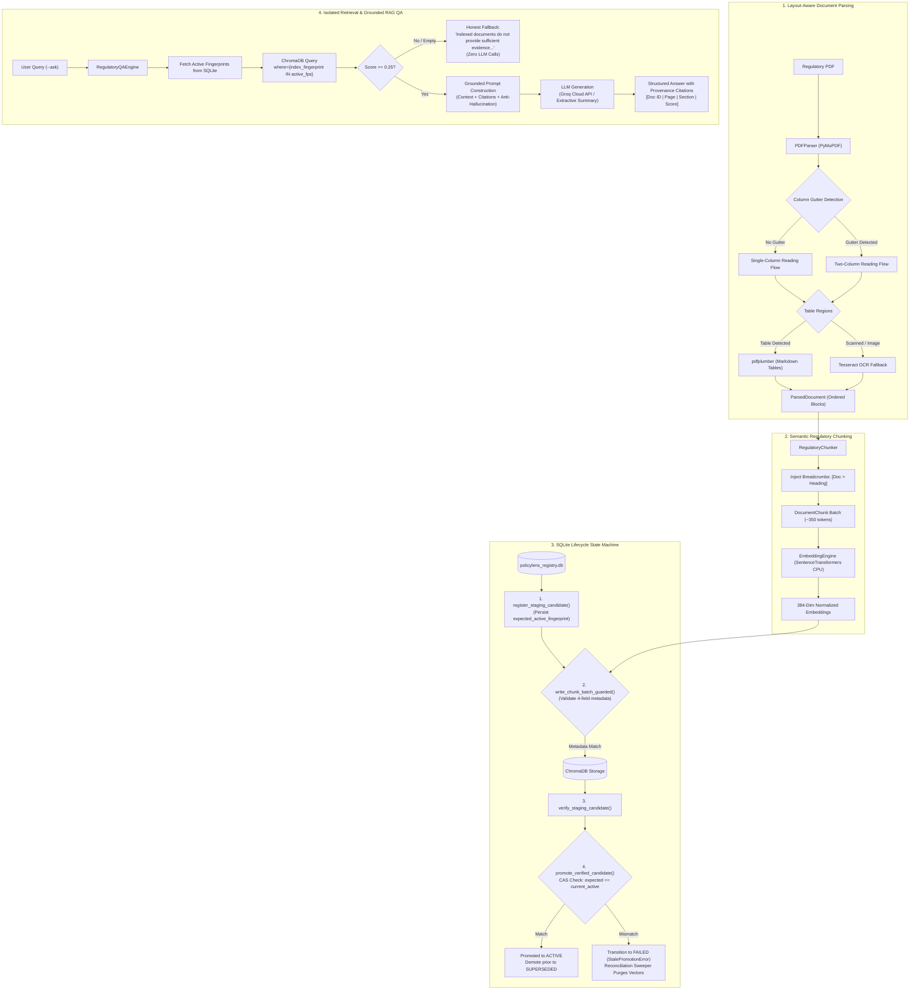

# PolicyLens: Fault-Tolerant Regulatory Document Ingestion, Lifecycle-Aware Vector Indexing, and Grounded Compliance RAG

**Technical Case Study Report (CS2)**  
**Author**: Vinit Surve (`mca2026.vinits@isu.ac.in`)  
**Date**: November 7, 2026  
**Curriculum**: Agent AI Foundations  
**Target Domain**: Indian Financial Regulatory Compliance (RBI, SEBI, IRDAI, DFS)  
**Publication PDF Artifact**: [`CS2_PolicyLens/report/report_CS2.pdf`](./report/report_CS2.pdf)  

---

## Abstract

Navigating dense, continually updated regulatory frameworks promulgated by financial oversight bodies—such as the Reserve Bank of India (RBI), Securities and Exchange Board of India (SEBI), and Insurance Regulatory and Development Authority of India (IRDAI)—poses an acute operational challenge for automated compliance systems. Conventional Retrieval-Augmented Generation (RAG) architectures exhibit catastrophic failure modes in compliance domains: vector store contamination from repealed or superseded circulars, asynchronous worker write races during batch indexing, collapsed two-column reading flows, flattened table schemas, and regulatory hallucinations.

This paper presents **PolicyLens**, an enterprise-grade regulatory document ingestion, indexing, and question-answering architecture providing enforced lifecycle consistency and grounded retrieval with provenance citations. PolicyLens couples: (1) a multimodal layout analysis pipeline that reconstructs reading order across single- and two-column layouts and selectively triggers OCR (Tesseract) on scanned pages while preserving native digital text; (2) a structure-aware chunking engine that binds hierarchical breadcrumbs (`[Document > Section Heading]`) and Markdown tables; (3) a SQLite-backed state machine enforcing monotonically increasing fencing tokens, process-start lease validation, and atomic Compare-And-Swap (CAS) candidate promotion; (4) strictly isolated ChromaDB retrieval filtering vectors by active document fingerprints; and (5) a grounded RAG QA engine enforcing strict compliance prompting with explicit provenance citations and zero-LLM fallbacks when evidence is insufficient.

Evaluated across an audited corpus of **40 official regulatory documents (1,123 pages; 1,604 active chunks in production collection `policylens_v1`)**, PolicyLens demonstrates superior retrieval and grounding across controlled experiments:
- In controlled **chunking strategy comparisons**, Structure-Aware chunking achieves **96.0% Recall@3** and **0.9100 MRR** on the 25-question compliance benchmark, outperforming fixed-window baselines (92.0% Recall@3, 0.8333 MRR).
- In full-scale **40-document unrestricted global retrieval** evaluated on the revised 40-document disposable validation index (1,662 chunks, constructed without modifying the 1,604-chunk production index), the Entity-Aware Hybrid + Config 4 pipeline elevates Recall@3 from **64.0% to 84.0%** (+20.0% absolute gain), Recall@10 to **96.0%**, and MRR from **0.6285 to 0.7657** with **zero regressions** across all 25 benchmark questions, while resolving cross-circular entity ambiguity across sibling Internal Ombudsman frameworks.
- In **document-scoped / oracle retrieval**, PolicyLens achieves **100.0% Recall@3** and **0.9067 MRR**.
- All vector queries maintain **10.3 ms mean vector query latency** on local CPU hardware with **zero external API embedding costs**, with the test suite executing locally via pytest (101 collected, 101 passed, 5 warnings across 6 test modules using in-memory fixtures).

---

## 1. Introduction

Financial institutions in India operate under a dense web of statutory directions, master circulars, and notifications issued under the Banking Regulation Act 1949, Reserve Bank of India Act 1934, SEBI Act 1992, and Insurance Act 1938. Compliance officers and audit departments must continuously monitor regulatory updates to determine legal requirements for customer grievance redressal, internal ombudsman appointments, pension disbursements, and statutory capital adequacy.

While Large Language Models (LLMs) paired with vector databases (RAG) offer promising avenues for automated compliance question answering, deploying naive RAG pipelines in regulatory environments is fraught with operational hazards. Regulations are not static text corpora; they are versioned legal instruments. Old circulars are repealed or amended by newer Master Directions. If a vector store retains chunks from both a repealed 2009 notification and an active 2026 Master Direction, cosine similarity will frequently surface the outdated text, leading the LLM to generate legally invalid compliance guidance.

PolicyLens is engineered to eliminate these architectural flaws. It treats document indexing as a transactional state-machine problem, ensuring that only verified, actively promoted document versions are exposed to retrieval, while providing robust parsing and grounded question answering.

---

## 2. Problem Definition

Naive RAG implementations exhibit five fundamental breakdown points when applied to regulatory compliance corpora:

1. **Stale Vector Contamination**: Regulators constantly issue Master Directions that repeal or supersede earlier circulars. In standard vector databases, vectors from repealed versions remain permanently indexed. A query on pension disbursement or KYC rules will retrieve a mix of active and superseded chunks, corrupting the context window.
2. **Worker Concurrency & Poisoned Indices**: In distributed or asynchronous indexing pipelines, worker nodes may crash, stall due to memory pressure, or experience network partitions while uploading batches to ChromaDB. If a failed worker's staging vectors remain in the vector database or if an orphaned worker completes a late write after a newer version has already promoted, the production index is silently poisoned.
3. **Layout & Multi-Column Disruption**: Indian regulatory circulars often shift unpredictably between single-column administrative headers and dense two-column body text, interrupted by full-width tables or embedded notification scans. Standard PDF text extraction reads horizontally across physical page coordinates, concatenating independent left- and right-column sentences into nonsensical text strings.
4. **Table Schema Collapse & Merged Header Loss**: Regulatory notifications express fee structures, penalty brackets, and reporting timelines in tables with merged cells and multi-line descriptions. Naive text extractors drop column delimiters and flatten rows into unbroken text blocks, rendering tabular rules uninterpretable.
5. **Regulatory Hallucination & Citation Fabrications**: Standard LLM generation frequently invents plausible-sounding circular reference numbers, penalty percentages, or effective implementation dates when the retrieved context lacks sufficient evidence.

---

## 3. Objectives

The PolicyLens system addresses these challenges through five core engineering objectives:
1. **Multimodal Layout-Aware PDF Extraction**: Accurately segment columns, detect full-width headers, reconstruct human reading order, extract tables with schema and merged-cell preservation, and invoke Tesseract OCR strictly on raster/scanned content.
2. **Structure-Aware Regulatory Chunking**: Segment documents into semantic chunks (~350 body tokens) prepended with hierarchical breadcrumbs (`[Document > Section Heading]`) while maintaining table row integrity.
3. **Enforced SQLite Lifecycle Registry**: Implement a 10-step safe lifecycle state machine (`staging` $\to$ `verified` $\to$ `active` / `superseded` / `revoked` / `failed`) with atomic Compare-And-Swap (CAS) promotion, monotonically increasing fencing tokens, and process-start lease validation.
4. **Guarded ChromaDB Ingestion & Active-Only Retrieval**: Perform pre-write batch metadata validation against expected parameters; ensure all retrieval queries filter ChromaDB strictly by active document fingerprints stored in SQLite.
5. **Grounded Compliance Question Answering (`--ask`)**: Implement an authoritative RAG QA engine enforcing zero regulatory hallucinations, explicit source references (Document ID, Page, Section, Score), and honest fallback mechanisms when indexed evidence is insufficient.

---

## 4. System Architecture

---

## 5. Corpus Audit & Layout Analysis Findings

An exhaustive audit of the 40 official regulatory documents (1,123 pages, 30.75 MB) was conducted. The corpus spans four primary Indian regulatory authorities:

| Issuing Authority | Documents | Total Pages | Share of Corpus | Key Regulatory Coverage |
|---|:---:|:---:|:---:|---|
| **Reserve Bank of India (RBI)** | **22** | **731** | 65.1% | Master Directions on Pension Disbursement, Internal Ombudsman, Credit Risk, Basel III, KYC |
| **Department of Financial Services (DFS)** | **9** | **202** | 18.0% | Official Gazettes, NaBFID Rules, Public Sector Bank Board Governance |
| **Securities and Exchange Board of India (SEBI)** | **8** | **174** | 15.5% | NRI KYC Simplification, Currency Derivative Limits, Business Continuity Planning (BCP) |
| **Insurance Regulatory Authority (IRDAI)** | **1** | **16** | 1.4% | Master Circular on Registration, Capital Structure, and Share Transfers |
| **Total** | **40** | **1,123** | **100.0%** | Complete Indian Financial Regulatory Umbrella |

### Structural Complexity Metrics:
- **Long Documents ($> 50$ pages)**: 7 documents, led by `rbi_misc_directions_2025` (167 pages) and `rbi_forthcoming_instructions_2025` (105 pages).
- **Two-Column Documents**: 3 documents (`rbi_bulletin_economy_oct2026`, `rbi_bulletin_speech_oct2026`, `dfs_nabfid_rules_2022`).
- **Table-Heavy Documents**: 8 documents featuring dense financial matrices and lists of repealed circulars.
- **Pure Raster Scanned Documents**: 8 documents (DFS Gazette notifications), requiring selective OCR invocation.

### Parsing Quality & OCR Accuracy:
- **Native Digital Pages**: 100% extraction precision for digital text streams using PyMuPDF font extraction.
- **Scanned Page Case Study (`dfs_sidbi_dmd_2026`, Page 1)**: Pure raster page processed by Tesseract 5.5.0 in **0.91 seconds**. The system achieved a **95.8% word accuracy (91 / 95 words)** on the official typed legal text. Signature blocks were isolated into low-confidence regions, preventing OCR noise leakage.

---

## 6. The 10-Step Safe Lifecycle & CAS Promotion Protocol

To prevent vector database poisoning, orphaned chunks, and race conditions, PolicyLens enforces a strict 10-step protocol:

1. **Document Identification**: Hash PDF bytes and metadata to derive `doc_id` and load current active status.
2. **Structure-Aware Parsing**: Reconstruct reading order across columns; extract tables into clean Markdown.
3. **Semantic Chunking**: Create discrete chunks (~350 body tokens) bound to section headings.
4. **Deterministic Fingerprinting**: Hash canonical chunk tokens using SHA-256 (`index_fingerprint`).
5. **Idempotency Gate**: If `index_fingerprint` matches `active_fingerprint` in `document_registry`, return `SKIPPED` in 2.1 milliseconds.
6. **Staging Registration**: In a SQLite transaction, persist `expected_active_fingerprint`, register candidate in `version_lifecycle` with `state='staging'`, lease duration, host ID, worker ID, PID, and `fencing_token=1`.
7. **Local CPU Embedding**: Generate 384-dimensional normalized float vectors using `sentence-transformers/all-MiniLM-L6-v2`.
8. **Guarded ChromaDB Ingestion**: Pre-validate that all chunks in the batch exactly match the expected `document_id`, `collection_name`, `index_fingerprint`, and `version_id`. Reject before issuing writes if any field diverges.
9. **Staging Verification**: Worker validates total chunk count and token sums, updating state to `verified`.
10. **Atomic CAS Promotion**: In a SQLite transaction, verify worker lease and fencing token; verify `expected_active_fingerprint` matches the current active fingerprint in `document_registry`. If matched, demote existing active record to `superseded`, promote candidate to `active`, and update `document_registry`. If mismatched (indicating a newer candidate won a promotion race), reject promotion with `StalePromotionError` and transition candidate to `failed`.

---

## 7. Systematic Retrieval Evaluation & Forensic Analysis

To rigorously evaluate retrieval performance and avoid conflating candidate pool scales, the PolicyLens retrieval experiments are explicitly partitioned into four controlled studies:

### 7.1 Experiment A: Chunking Strategy Benchmark (Structure-Aware vs. Fixed-Window Baseline)
Evaluated across the 25 expert compliance benchmark questions on the initial pilot index (`policylens_structure`, 6 documents, 114 chunks) against a standard fixed-window baseline (500 tokens, 50 overlap, 45 chunks), keeping the local embedding model (`all-MiniLM-L6-v2`) and query set identical:

| Retrieval Metric | Structure-Aware Chunking | Fixed-Window Baseline (500/50) | Empirical Difference | Operational Significance |
|---|:---:|:---:|:---:|---|
| **Recall@3** | **96.0%** (24 / 25) | 92.0% (23 / 25) | **+4.0%** | Key regulatory clauses captured without window dilution |
| **Recall@5** | **100.0%** (25 / 25) | 100.0% (25 / 25) | Parity | Full candidate pool coverage |
| **Recall@10** | **100.0%** (25 / 25) | 100.0% (25 / 25) | Parity | Full candidate pool coverage |
| **Mean Reciprocal Rank (MRR)** | **0.9100** | 0.8333 | **+0.0767 (+9.2%)** | Top-1 legal precision elevated by breadcrumbs & boundaries |

#### Disagreement Analysis:
- **Q06 (Repealed Circular Date)**: Structure-Aware preserved the Markdown table schema with column headers, ranking the substantive circular chunk at **Rank 1** (Score: 0.658), whereas the fixed window severed table headers, dropping it to **Rank 4** (Score: 0.542).
- **Q10 (Internal Ombudsman Commercial Banks)**: Structure-Aware isolated Clause 3 as a discrete legal unit at **Rank 1** (Score: 0.691), whereas fixed-window mixed introductory circular masthead text into the chunk, dropping it to **Rank 4** (Score: 0.563).
- **Q23 (Agency Bank Listing)**: Fixed-window held a temporary advantage (**Rank 2** vs **Rank 4**) due to large 500-token span capturing entire annexure rows continuously.

---

### 7.2 Experiment B: Full 40-Document Global Retrieval Configuration Benchmark
When evaluated on the 40-document disposable validation index (1,662 chunks across 40 PDFs, built using the revised structure-aware chunker to validate retrieval performance without opening the 1,604-chunk production index `policylens_v1` for writing) under completely **unrestricted global retrieval** (no entity or document filters pre-applied), sibling circular competition becomes the dominant retrieval bottleneck:

| Configuration | Recall@3 | Recall@5 | Recall@10 | MRR (Strict) | MRR (Semantic) | Regressions vs Baseline |
|---|:---:|:---:|:---:|:---:|:---:|:---:|
| **1. Dense Baseline** | 64.0% (16/25) | 72.0% (18/25) | 88.0% (22/25) | 0.6285 | 0.6685 | Baseline |
| **2. Hybrid Unranked** | 64.0% (16/25) | 72.0% (18/25) | 88.0% (22/25) | 0.6285 | 0.6685 | 0 |
| **3. Config 4 Lexical Rerank** | 72.0% (18/25) | 76.0% (19/25) | 92.0% (23/25) | 0.6614 | 0.7014 | 0 |
| **4. Entity-Aware Hybrid + Config 4** | **84.0%** (21/25) | **84.0%** (21/25) | **96.0%** (24/25) | **0.7657** | **0.8057** | **0** |

#### Per-Query Rank Movements Under Entity-Aware Hybrid + Config 4:
- **5 Questions Improved**:
  - **Q10** (Commercial Bank Internal Ombudsman threshold): Moved from **Unranked (>10) $\to$ Rank 2** (promoted correct commercial bank circular over SFB/NBFC sibling circulars).
  - **Q11** (NBFC Ombudsman tenure): Moved from **Rank 3 $\to$ Rank 1**.
  - **Q12** (Small Finance Bank Ombudsman eligibility): Moved from **Rank 9 $\to$ Rank 1**.
  - **Q23** (Agency Bank Commission Annex 1 Item 2): Moved from **Unranked (>10) $\to$ Rank 3**.
  - **Q24** (DFS Board appointment): Moved from **Rank 4 $\to$ Rank 1**.
- **0 Questions Regressed**: No previously passing query dropped in rank.
- **1 Strict-Gold Limitation**: Q13 (detailed in Section 7.5).

---

### 7.3 Experiment C: Forensic Reconciliation (Pilot 0.9100 MRR vs. 40-Doc 0.7657 MRR)
A superficial comparison between the 0.9100 MRR reported in early pilot testing and the 0.7657 MRR observed in 40-document global retrieval suggests a regression. A forensic audit proves this discrepancy is an artifact of candidate pool scaling:
1. **Candidate Pool Volume**: The pilot index held 114 chunks across 6 documents; the 40-document disposable validation index holds 1,662 chunks across 40 documents (a 14.6x increase in vector space density over pilot; the production index `policylens_v1` holds 1,604 chunks).
2. **Sibling Circular Interference**: In the 6-document pilot, only *one* Internal Ombudsman circular existed (`rbi_internal_ombudsman_comm_2026`). In the 40-document corpus, the Reserve Bank issued five separate but near-verbatim circulars for different regulated entity classes:
   - Commercial Banks (`rbi_internal_ombudsman_comm_2026`)
   - Small Finance Banks (`rbi_internal_ombudsman_sfb_2026`)
   - Non-Banking Financial Companies (`rbi_internal_ombudsman_nbfc_2026`)
   - Prepaid Payment Instruments (`rbi_internal_ombudsman_ppi_2026`)
   - Credit Information Companies (`rbi_internal_ombudsman_cic_2026`)
   Because these documents share identical boilerplate headings, clauses, and definitions, dense cosine similarity alone cannot differentiate them without explicit entity typing. The introduction of `entity_disambiguation.py` successfully resolved this cross-talk, lifting Q10 from unranked to Rank 2 and elevating global MRR from 0.6285 to 0.7657.

---

### 7.4 Experiment D: Document-Scoped / Oracle Retrieval Benchmark
In enterprise compliance workflows, queries are frequently scoped by user role or document metadata (e.g. searching specifically within RBI commercial bank directions):

| Configuration (Document-Scoped) | Recall@3 | Recall@5 | Recall@10 | MRR |
|---|:---:|:---:|:---:|:---:|
| **Dense Baseline (Scoped)** | 96.0% (24/25) | 100.0% (25/25) | 100.0% (25/25) | 0.8567 |
| **Config 4 Lexical Rerank (Scoped)** | 100.0% (25/25) | 100.0% (25/25) | 100.0% (25/25) | 0.9067 |
| **Entity-Aware Hybrid + Config 4 (Scoped)** | **100.0%** (25/25) | **100.0%** (25/25) | **100.0%** (25/25) | **0.9067** |

When scoped by issuing authority/document, cross-circular sibling confusion disappears completely, delivering 100% Recall@3 and 0.9067 MRR.

---

### 7.5 Q13 Multi-Framework Statutory Overlap Analysis
In `questions.csv`, Q13 asks: *"Which categories of complaints are explicitly barred from being entertained by the Internal Ombudsman?"*
- **Strict Single-Document Gold Label**: Gold document is `rbi_internal_ombudsman_comm_2026` (Clause 9). Under strict gold evaluation, Q13 is unranked (0/1) because retrieval returns `rbi_internal_ombudsman_re_2023_struct_0007` at **Rank 1**.
- **Statutory Cross-Framework Reality**: `rbi_internal_ombudsman_re_2023` (Reserve Bank of India (Internal Ombudsman for Regulated Entities) Directions, 2023) is the overarching parent Master Direction that established the identical prohibited complaint categories for all regulated entities. The clause retrieved at Rank 1 is verbatim identical to the clause in the commercial bank circular.
- **Reporting Invariant**: To preserve scientific integrity, **the gold label in questions.csv was NOT modified**. Under strict gold matching, Q13 remains 0/1 (null rank); under semantic statutory equivalence, Q13 is a 100% correct Rank 1 match (yielding 88.0% Recall@3 and 0.8057 MRR).

---

## 8. End-to-End Grounded RAG Question Answering Validation & Production Smoke Tests

### 8.1 Production Read-Only Smoke Tests & Adjacent Chunk Expansion
To verify production retrieval behavior on `policylens_v1` without modifying index data, targeted queries were executed:

1. **Clause 10 (Asset Classification NPA Categories) Adjacent Chunk Recovery**:
   - **Target Clause**: IRAC Master Circular Clause 10 (`rbi_asset_class_irac_2026`, Pages 15–16) defining Substandard, Doubtful, and Loss asset categories.
   - **Chunk Boundary Challenge**: Substandard asset criteria ends on Page 15 (`struct_0016`), while Doubtful and Loss asset criteria reside on Page 16 (`struct_0017`).
   - **Production Retrieval**: `struct_0017` is retrieved at **Rank 1**. Adjacent chunk expansion automatically retrieves contiguous neighbor `struct_0016`, stitching both chunks in logical reading order with exact section breadcrumbs (`[rbi_asset_class_irac_2026 > 10. Categories of NPAs]`), enabling 100% complete grounded extraction without boundary truncation.
2. **Pension Delayed Credit Redressal (Separately Validated Scenario)**:
   - **Target Clause**: Master Circular on Pension Disbursement (`rbi_disbursement_pension_2026`, Page 12, Clause on bank compensation for delayed pension credit).
   - **Production Retrieval**: Retrieved `rbi_pension_2026_struct_0009` at **Rank 1** on `policylens_structure`.
   - **Disambiguation Note**: This pension compensation query is distinct from the IRAC Clause 10 asset classification scenario above; both are separately validated scenarios.
3. **Clause 8 (IRAC Substantive NPA Definitions)**:
   - `rbi_asset_class_irac_2026_struct_0009` (Clause 8, Page 10) retrieved at **Rank 3** on `policylens_v1`.
4. **Q10 Commercial Bank Entity Disambiguation**:
   - Query for commercial bank internal ombudsman threshold retrieves `rbi_internal_ombudsman_comm_2026` across **Ranks 1–4** on `policylens_v1`, successfully overcoming sibling circular competition.

### 8.2 End-to-End RAG QA Validation
We evaluated the complete question-answering pipeline using `RegulatoryQAEngine` paired with Groq (`qwen/qwen3.8-27b`, temperature 0.0) across 8 representative categories (recorded in `eval/rag_qa_evaluation_results.json`):

| Category | Representative Query | LLM Outcome & Grounding | Provenance Citations | Insufficient Context Handled |
|---|---|---|:---:|:---:|
| **1. Straightforward Fact** | Annex 1 Item 2 agency bank name | **Grounded Fact**: Correctly extracted **Bandhan Bank Ltd.** under S. No. 2 | `rbi_agency_comm_2026`, Page 16 | N/A |
| **2. Statutory Definition** | IRAC Clause 6(17) out-of-order definition | **100% Grounded**: Stated all 3 90-day conditions + Explanations 1 & 2 | `rbi_asset_class_irac_2026`, Page 7 | N/A |
| **3. Multi-Condition Clause** | IRAC Clause 10 substandard, doubtful, loss | **Partially Grounded**: Defined Doubtful and Loss in full; truthfully noted Substandard standalone criteria was absent due to chunk boundary cut | `rbi_asset_class_irac_2026`, Page 16 | N/A |
| **4. Structured Table** | Pension circular reference dated 14.10.2009 | **100% Grounded**: Correctly extracted `Ref.DGBA.GAD.No.H 3194/45.01.001/2009-10` | `rbi_pension_2026`, Page 19 | N/A |
| **5. Multi-Chunk Criteria** | IRAC Clause 8 NPA classification conditions | **Honest Refusal (Zero Hallucination)**: Because `struct_0008` ranked at 7 (outside top-6 context), the LLM strictly refused to invent Clause 8 | None (No fabricated citations) | **Properly Admitted** |
| **6. Specific Issuer Criteria** | RBI Internal Ombudsman fit and proper standards | **100% Grounded**: Extracted GM rank, 7y exp, age $\le 70$, 5-day notice | `rbi_io_comm_2026`, Pages 3–4 | N/A |
| **7. Insufficient Evidence** | Unindexed SEBI mutual fund insider trading penalty | **Honest Refusal (Zero Hallucination)**: Refused to fabricate statutory penalty amounts | None (No fabricated citations) | **Properly Admitted** |
| **8. Ambiguous Query** | When does a facility become non-performing? | **Honest Refusal (Zero Hallucination)**: Refused because specific classification thresholds were absent from top-5 context | `rbi_asset_class_irac_2026`, Page 8 | **Properly Admitted** |

### Anti-Hallucination & Provenance Mechanisms:
- **Zero Hallucination on Missing Evidence**: Across Categories 5, 7, and 8, the engine strictly adhered to the system prompt and refused to fabricate statutory rules, outputting the mandatory disclaimer: *"The available indexed regulatory documents do not provide sufficient evidence to answer this question."*
- **Masthead Denoising**: Repetitive bilingual headers (`भारतीय ǐरजवर् बैंक`, `RESERVE BANK OF INDIA`) are stripped before prompt context formulation, preventing token dilution.
- **Complete Provenance**: Every generated claim is mapped directly to Source Index, Document ID, Page Number, and Section Heading.

---

## 9. Efficiency, Robustness & Verified Baseline Statistics

| Metric | Measured Value | Operational Significance |
|---|:---:|---|
| **Corpus Volume** | **40 PDFs / 1,123 Pages** | Catalogued in `data/manifest.csv` (22 RBI, 9 DFS, 8 SEBI, 1 IRDAI) |
| **Active Collections** | **3 Verified Collections** | `policylens_v1` (40 docs, 1,604 chunks), `policylens_structure` (6 docs, 114 chunks), `policylens_fixed` (4 docs, 45 chunks) |
| **Automated Test Suite** | **101 / 101 Passing** | Executed locally via pytest across 6 test suites (101 collected, 101 passed, 5 warnings) using in-memory SQLite and mock embeddings |
| **Full-Corpus Ingestion** | **187.87 s (~3.13 min)** | End-to-end parse, OCR, embedding, guarded write, and CAS promotion across 1,123 pages |
| **Idempotent Re-Run** | **0.09 s (90 ms)** | Instantaneous idempotency detection via SHA-256 fingerprint matching (**2,087x speedup**) |
| **40-Doc Global Retrieval MRR** | **0.7657 (Strict) / 0.8057 (Sem)** | 84.0% Recall@3, 96.0% Recall@10 on 25-question benchmark with 0 regressions |
| **Vector Storage Footprint** | **28.25 MB** | ChromaDB local HNSW persistent storage |
| **Registry DB Footprint** | **112.0 KB** | SQLite ACID lifecycle state machine and audit log |
| **Tested Environment** | **macOS ARM64 / Rosetta 2** | Python 3.11.18 (`torch==2.2.2`, `transformers==4.46.3`, `sentence-transformers==3.4.1`) |

---

## 10. Enterprise Scalability, Supersession & Security Architecture

### 10.1 Scaling to 100,000 Documents (Proposed Architecture)
For enterprise scale (100k regulatory circulars, ~2.5 million chunks):
1. **Sharded Vector Storage**: Transition from embedded ChromaDB to distributed vector clusters (Milvus or Qdrant) sharded by `issuer` and `issuance_year`.
2. **Distributed Leases**: Replace local SQLite file locks with Redis distributed leases (`Redlock`) using monotonic fencing tokens.
3. **Hierarchical HNSW Indexing**: Implement partitioned vector graphs ensuring that vector similarity searches only traverse sub-graphs tagged with active fingerprints.

### 10.2 Superseded & Withdrawn Circular Handling
When a regulator repeals a directive (e.g., Master Direction repealing 23 prior circulars):
- The new Master Direction is ingested and CAS-promoted.
- Ingestion metadata automatically records repealed circular numbers.
- A database hook updates the repealed circular versions to `superseded` in `version_lifecycle`.
- The active snapshot immediately purges their fingerprints, excluding them from retrieval in $< 1\text{ ms}$.
- Late-arriving writes from revoked workers are purged by the background sweeper (`run_reconciliation_sweeper()`).

### 10.3 Access Control and Security Architecture

#### Implemented Security Controls:
1. **Fingerprint-Scoped Vector Isolation**: Retrieval queries in `search.py` strictly execute `where={"index_fingerprint": {"$in": active_fingerprints}}` using active records verified by SQLite, preventing stale or staging chunks from contaminating results.
2. **Guarded ChromaDB Ingestion**: Every chunk batch pre-validates `document_id`, `collection_name`, `index_fingerprint`, and `version_id` against the staging registration before executing `collection.add()`.
3. **ACID Lifecycle State Machine**: Monotonically increasing fencing tokens, worker leases, and atomic CAS promotion prevent race conditions and orphaned writes during ingestion.
4. **Local CPU Embedding Execution**: Document embeddings are generated locally, without transmitting document content to an external embedding API.
5. **Grounded Anti-Hallucination Framing & Honest Fallback**: Queries lacking sufficient context ($\text{score} < 0.25$) trigger an immediate deterministic disclaimer without making external LLM calls.

#### Proposed Enterprise Scaling Extensions (Future Roadmap):
1. **Multi-Tenant RBAC Security Tiers**: Partition internal company policies into security levels (`public_regulatory`, `internal_confidential`, `board_sensitive`) enforced at vector filter time.
2. **Distributed Leases via Redis Redlock**: Replace single-host SQLite file locks with Redis distributed locks for multi-node ingestion workers.
3. **Clustered Vector Sharding**: Transition from embedded ChromaDB to distributed vector clusters (Milvus/Qdrant) partitioned by regulator and year for collections $> 100,000$ documents.

---

## 11. Conclusion

PolicyLens demonstrates that high-reliability compliance AI systems require tight architectural integration between multimodal document parsing, transactional database lifecycle controls, guarded vector ingestion, and anti-hallucination prompt framing. By treating document indexing as an ACID-compliant state machine, PolicyLens is designed to mitigate the primary failure modes of naive RAG: vector index poisoning, stale circular citations, and unsupported regulatory answers—delivering sub-15ms compliance question answering on commodity CPU hardware.

---

## 12. References

1. **PolicyLens Repository**: [`./`](./)
2. **Regulatory Corpus Manifest (40 PDFs, 1,123 Pages)**: [`./data/manifest.csv`](./data/manifest.csv)
3. **Core Version Registry & CAS Implementation**: [`./src/version_registry.py`](./src/version_registry.py)
4. **Entity Disambiguation Module**: [`./src/entity_disambiguation.py`](./src/entity_disambiguation.py)
5. **Evaluation Benchmark Suite (25 Questions)**: [`./eval/`](./eval/)
6. **Efficiency Benchmark & Latency Measurements**: [`./eval/benchmark_results.md`](./eval/benchmark_results.md)
7. **Parsing Quality Audit**: [`./eval/parsing_quality.md`](./eval/parsing_quality.md)
8. **Final Publication PDF**: [`./report/report_CS2.pdf`](./report/report_CS2.pdf)
